# Come funziona Spring — la mappa completa

Un documento di riferimento su **tutto** il funzionamento di un'applicazione Spring Boot come la nostra: gli strati, i pezzi dentro ogni strato, come si parlano, le librerie e le annotazioni. Non è legato a un passo: lo riprenderai ogni volta che un pezzo nuovo entra nel progetto. Ogni sezione dice **quando** ti servirà ("Nel progetto: passo N").

**I diagrammi** sono scritti in Mermaid, un formato testuale per diagrammi:
- su **GitHub** si vedono già disegnati;
- in **VS Code** serve l'estensione *Markdown Preview Mermaid Support* (`bierner.markdown-mermaid`); poi `Ctrl+Shift+V` sull'anteprima.

**Le versioni** citate sono quelle realmente usate dal progetto (lette dalla cache di Maven il 2026-10-19). Le affermazioni sul comportamento sono verificate sul nostro backend dove indicato; il resto è il comportamento documentato di Spring.

---

## Indice

0. [La mappa in una pagina](#parte-0--la-mappa-in-una-pagina)
1. [La famiglia Spring e le librerie](#parte-1--la-famiglia-spring-e-le-librerie)
2. [Il cuore: il contenitore IoC](#parte-2--il-cuore-il-contenitore-ioc)
3. [I proxy e l'AOP: il trucco dietro le annotazioni](#parte-3--i-proxy-e-laop-il-trucco-dietro-le-annotazioni)
4. [L'avvio di Spring Boot](#parte-4--lavvio-di-spring-boot)
5. [Lo strato web](#parte-5--lo-strato-web)
6. [Lo strato di servizio e le transazioni](#parte-6--lo-strato-di-servizio-e-le-transazioni)
7. [Lo strato di persistenza](#parte-7--lo-strato-di-persistenza)
8. [La validazione su tre livelli](#parte-8--la-validazione-su-tre-livelli)
9. [La sicurezza (anteprima)](#parte-9--la-sicurezza-anteprima)
10. [I servizi trasversali](#parte-10--i-servizi-trasversali)
11. [I test](#parte-11--i-test)
12. [Tutto insieme: il viaggio di una prenotazione](#parte-12--tutto-insieme-il-viaggio-di-una-prenotazione)
13. [Il modello a thread](#parte-13--il-modello-a-thread)
14. [Prontuario delle annotazioni](#parte-14--prontuario-delle-annotazioni)
15. [Domande da colloquio](#parte-15--domande-da-colloquio)
16. [Documentazione ufficiale](#parte-16--documentazione-ufficiale)

---

## Parte 0 — La mappa in una pagina

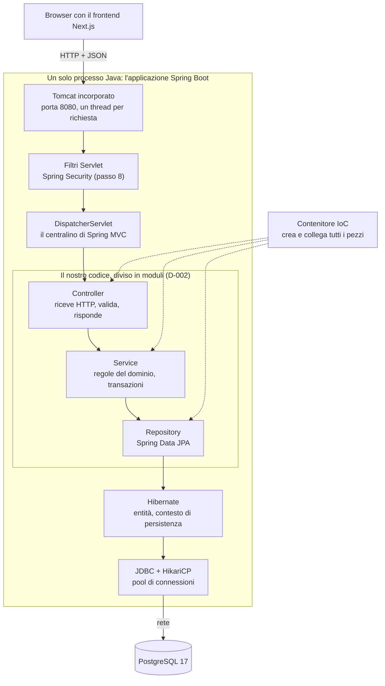

| Strato | Responsabilità | Pezzi principali | Libreria | Nel progetto |
|---|---|---|---|---|
| Server | Accettare connessioni HTTP | Tomcat, thread | `tomcat-embed-core` | Già attivo |
| Filtri | Controlli prima di Spring MVC | `Filter`, catena di sicurezza | Spring Security | Passo 8 |
| Web | Tradurre HTTP ↔ Java | `DispatcherServlet`, controller, Jackson | `spring-webmvc`, Jackson 3 | Passo 5 in poi |
| Servizio | Regole e transazioni | `@Service`, `@Transactional` | `spring-context`, `spring-tx` | Passo 5 in poi |
| Persistenza | Leggere e scrivere dati | Repository, Hibernate, JDBC | Spring Data JPA, Hibernate, HikariCP | Passo 4 (ora) |
| Database | Conservare e proteggere i dati | Tabelle, vincoli | PostgreSQL, Flyway | Passo 4 (ora) |

**Le quattro idee che tengono insieme tutto.** Se capisci queste, il resto è dettaglio:

1. **Il contenitore IoC.** Non sei tu a creare gli oggetti principali con `new`: li crea Spring, e li collega tra loro (parte 2).
2. **I proxy.** Davanti a molti dei tuoi oggetti Spring mette un **intermediario** che aggiunge comportamento: apre le transazioni, controlla i permessi, implementa i repository. Quasi tutte le annotazioni "magiche" funzionano così (parte 3).
3. **Convenzione e auto-configurazione.** Spring Boot guarda cosa c'è nel progetto e configura da solo i pezzi standard (parte 4).
4. **Un thread per richiesta.** Ogni richiesta HTTP viaggia su un thread, e molte cose (la transazione, l'utente autenticato) sono "appese" a quel thread (parte 13).

---

## Parte 1 — La famiglia Spring e le librerie

### 1.1 Chi è chi

| Nome | Cos'è |
|---|---|
| **Spring Framework** | Il cuore: il contenitore IoC, AOP, transazioni, accesso ai dati, web MVC, test. Versione **7.0** |
| **Spring Boot** | Sopra il Framework: auto-configurazione, starter, server incorporato, configurazione esterna. Versione **4.1** |
| **Spring Data JPA** | I repository generati dalle interfacce. Versione **4.1** |
| **Spring Security** | Autenticazione e autorizzazione (passo 8) |

Il Framework è diviso in moduli, ognuno un jar:

| Modulo | Contenuto |
|---|---|
| `spring-core`, `spring-beans` | Le fondamenta: gestione dei bean, conversione dei tipi, risorse |
| `spring-context` | L'`ApplicationContext`, gli stereotipi (`@Service`...), gli eventi, la pianificazione (`@Scheduled`) |
| `spring-aop` | I proxy e l'AOP |
| `spring-tx` | Le transazioni (`@Transactional`) |
| `spring-jdbc` | `JdbcTemplate`, `JdbcClient`, la traduzione delle eccezioni SQL |
| `spring-orm` | L'integrazione con JPA e Hibernate |
| `spring-web`, `spring-webmvc` | HTTP, `DispatcherServlet`, controller |
| `spring-test` | Il supporto ai test (`MockMvc`, `@MockitoBean`) |

### 1.2 Specifiche e implementazioni: lo stesso schema ovunque

Hai già incontrato lo schema con JDBC (verifica 02): **un contratto standard, e un'implementazione che lo realizza**. In Spring Boot è dappertutto:

| Specifica (il contratto) | Package | Implementazione usata | Versione |
|---|---|---|---|
| JDBC | `java.sql` (nel JDK) | Driver PostgreSQL | 42.7 |
| Jakarta Persistence (JPA) | `jakarta.persistence` | **Hibernate** | 3.2 → Hibernate 7.4 |
| Jakarta Validation | `jakarta.validation` | **Hibernate Validator** | 3.1 → 9.1 |
| Jakarta Servlet | `jakarta.servlet` | **Tomcat** | 6.1 → Tomcat 11.0 |
| SLF4J (logging) | `org.slf4j` | **Logback** | 2.0 → 1.5 |

Il tuo codice parla con il contratto; l'implementazione si può cambiare senza riscriverlo.

### 1.3 Le librerie del progetto

| Libreria | Versione | Ruolo |
|---|---|---|
| Spring Framework | 7.0.9 | Il cuore |
| Spring Boot | 4.1.1 | Auto-configurazione, avvio |
| Tomcat (incorporato) | 11.0.24 | Server HTTP |
| Jackson | 3.1.5 | Conversione Java ↔ JSON (package `tools.jackson`) |
| Hibernate ORM | 7.4.5 | Implementazione di JPA |
| Spring Data JPA | 4.1.1 | Repository |
| HikariCP | 7.0.2 | Pool di connessioni |
| Driver PostgreSQL | 42.7.13 | JDBC per PostgreSQL |
| Flyway | 12.4.0 | Migrazioni |
| Hibernate Validator | 9.1.3 | Validazione |
| Logback / SLF4J | 1.5 / 2.0 | Log |
| JUnit Jupiter | 6.0.3 | Test |
| AssertJ / Mockito | 3.27 / 5.23 | Verifiche nei test / oggetti finti |
| Testcontainers | 2.0.5 | Database vero nei test |

In Spring Boot 4 l'auto-configurazione è divisa in moduli, uno per tecnologia: `spring-boot-webmvc`, `spring-boot-tomcat`, `spring-boot-jackson`, `spring-boot-jdbc`, `spring-boot-jpa`, `spring-boot-hibernate`, `spring-boot-flyway`, `spring-boot-transaction`, `spring-boot-validation`. Gli starter li portano dentro (guida 01, 5.3).

---

## Parte 2 — Il cuore: il contenitore IoC

### 2.1 Bean e `ApplicationContext`

**Inversione del controllo** (*Inversion of Control*): non è il tuo codice a creare e collegare gli oggetti, è il framework. Tu dichiari **cosa** serve; Spring decide **come** e **quando** crearlo.

| Termine | Significato |
|---|---|
| **Bean** | Un oggetto creato e gestito da Spring |
| **`ApplicationContext`** | Il contenitore: crea i bean, li collega, li conserva, li chiude. Ce n'è uno per applicazione |
| **`BeanDefinition`** | La "ricetta" di un bean: classe, dipendenze, scope. Spring prima raccoglie tutte le ricette, poi crea i bean |
| **`BeanFactory`** | La parte del contenitore che crea i bean; l'`ApplicationContext` la estende con eventi, configurazione, risorse |

### 2.2 Come si dichiara un bean

**Con un'annotazione sulla classe** (stereotipo), trovata dal *component scan* (guida 01, 4.3):

| Annotazione | Per cosa | Particolarità |
|---|---|---|
| `@Component` | Un bean generico | La base di tutte le altre |
| `@Service` | Logica di dominio | Nessun comportamento in più: dichiara il ruolo |
| `@Repository` | Accesso ai dati | Attiva la **traduzione delle eccezioni** del database in eccezioni Spring (7.4). I repository di Spring Data non ne hanno bisogno: sono già bean |
| `@Controller` | Controller web che restituisce pagine | Non lo useremo |
| `@RestController` | Controller web che restituisce dati (JSON) | = `@Controller` + `@ResponseBody` |
| `@Configuration` | Una classe che contiene metodi `@Bean` | Spring ne crea un proxy, perché più chiamate allo stesso metodo `@Bean` restituiscano **lo stesso** oggetto |

**Con un metodo `@Bean`** dentro una classe `@Configuration`: quando la classe non è tua (una libreria) o la creazione richiede logica. Esempio futuro: la `SecurityFilterChain` del passo 8.

```java
@Configuration
class ClockConfig {
    @Bean
    Clock clock() {                 // a bean of a class we don't own
        return Clock.systemUTC();
    }
}
```

(Un `Clock` come bean è un trucco utile: nei test lo sostituisci con un orologio fermo, e le regole sul preavviso di cancellazione diventano provabili.)

### 2.3 L'iniezione delle dipendenze

**Tramite costruttore: il modo da usare sempre.**

```java
@Service
class LoanService {
    private final LoanRepository loans;      // final: assigned once, never null
    private final Clock clock;

    LoanService(LoanRepository loans, Clock clock) {   // one constructor: no @Autowired needed
        this.loans = loans;
        this.clock = clock;
    }
}
```

Perché il costruttore:
- i campi possono essere **`final`**: l'oggetto è completo dal primo istante, mai a metà;
- le dipendenze sono **visibili**: un costruttore con dieci parametri ti dice che la classe fa troppo;
- nei test unitari crei l'oggetto con `new` e gli passi oggetti finti, **senza Spring**;
- con un solo costruttore `@Autowired` non serve.

**Sui campi** (`@Autowired private LoanRepository loans;`): molto diffusa nel codice vecchio, sconsigliata. Campi non `final`, dipendenze nascoste, test che richiedono Spring o la *reflection*.

**Più bean dello stesso tipo:**

| Strumento | Uso |
|---|---|
| `@Primary` | Su un bean: è quello scelto di default |
| `@Qualifier("nome")` | Nel punto di iniezione: scelgo quel bean preciso |
| `List<Interfaccia>` | Ricevo **tutti** i bean che la implementano (utile per il pattern *strategy*) |

**Dipendenze circolari.** Se A ha bisogno di B e B di A, dalla versione 2.6 Spring Boot si **rifiuta di partire**. Non va aggirato: è il segnale che una responsabilità è nel posto sbagliato. Con i moduli di D-002 conta ancora di più: due moduli che si chiamano a vicenda non sono due moduli.

### 2.4 Gli *scope*

| Scope | Quante istanze | Uso |
|---|---|---|
| `singleton` (default) | **Una** per tutta l'applicazione | Quasi tutto: servizi, repository, controller |
| `prototype` | Una nuova ogni volta che viene chiesta | Raro |
| `request` | Una per richiesta HTTP | Raro |
| `session` | Una per sessione HTTP | Raro |

**Conseguenza importante del singleton:** lo stesso oggetto `BookingService` serve **tutte** le richieste, su thread diversi, nello stesso momento. Quindi un bean singleton **non deve avere stato modificabile** nei suoi campi (niente "ultimo cliente elaborato" in un campo). Lo stato sta nei parametri, nelle variabili locali e nel database. È uno dei motivi per cui i campi iniettati sono `final`.

### 2.5 Il ciclo di vita di un bean

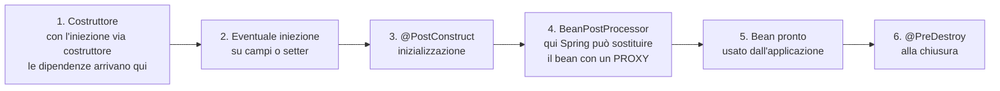

Il passaggio 4 è quello che spiega quasi tutta la "magia": i **`BeanPostProcessor`** sono bean speciali che possono esaminare e **sostituire** ogni bean appena creato. Se un bean ha metodi `@Transactional`, quello che finisce nel contenitore non è il tuo oggetto, ma un proxy che lo avvolge (parte 3).

### 2.6 Gli eventi

Un bean può pubblicare un **evento** (un oggetto qualsiasi, oggi spesso un `record`) e altri bean possono reagire, senza conoscersi:

| Strumento | Cosa fa |
|---|---|
| `ApplicationEventPublisher.publishEvent(evento)` | Pubblica |
| `@EventListener` | Reagisce, subito, nella stessa transazione |
| `@TransactionalEventListener` | Reagisce **solo dopo il `commit`** (di default) della transazione che ha pubblicato |

**Nel progetto (passi 7–9):** "prenotazione confermata → invia email". Se l'email partisse dentro la transazione e poi la transazione fallisse, il cliente riceverebbe la conferma di una prenotazione che non esiste. Con `@TransactionalEventListener` l'email parte solo a dati salvati. È anche il modo per mantenere separati i moduli: `booking` pubblica, `notification` ascolta.

---

## Parte 3 — I proxy e l'AOP: il trucco dietro le annotazioni

### 3.1 Cos'è un proxy

Un **proxy** è un oggetto che si mette **davanti** al tuo, ha gli stessi metodi, e quando lo chiami fa qualcosa **prima e dopo** aver passato la chiamata all'oggetto vero.

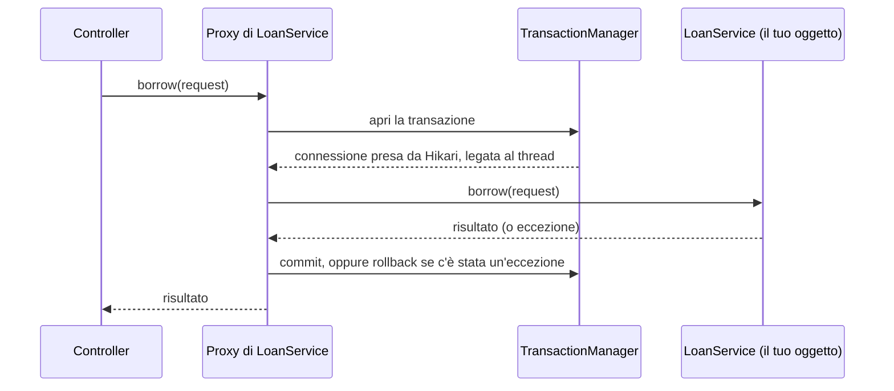

Il controller **crede** di parlare con `LoanService`: in realtà Spring gli ha iniettato il proxy. Questo modo di aggiungere un comportamento "attorno" ai metodi si chiama **AOP** (*Aspect-Oriented Programming*): il comportamento aggiunto (transazioni, sicurezza, log) è un **aspetto**, trasversale a molte classi.

### 3.2 Cosa funziona grazie a un proxy

| Annotazione / meccanismo | Cosa aggiunge il proxy | Parte |
|---|---|---|
| `@Transactional` | Apre e chiude la transazione | 6 |
| Repository di Spring Data | **Tutta l'implementazione**: l'interfaccia non ha codice, il proxy lo fornisce | 7 |
| `@PreAuthorize` | Controlla i permessi prima del metodo | 9 |
| `@Async` | Esegue il metodo su un altro thread | 13 |
| `@Cacheable` | Restituisce il risultato salvato invece di eseguire il metodo | — |
| `@Validated` su una classe | Valida i parametri dei metodi | 8 |
| `@Configuration` | Fa sì che un metodo `@Bean` restituisca sempre lo stesso oggetto | 2 |

### 3.3 Due tipi di proxy

| Tipo | Come funziona | Quando |
|---|---|---|
| **Proxy JDK** | Implementa la stessa **interfaccia** | Repository di Spring Data (sono interfacce) |
| **CGLIB** | Crea una **sottoclasse** della tua classe | Spring Boot lo usa di default per le classi (`@Service` con `@Transactional`) |

Conseguenza di CGLIB: un metodo **`final`** o **`private`** non può essere sovrascritto dalla sottoclasse, quindi **il proxy non lo intercetta**. Un `@Transactional` su un metodo `private` viene **ignorato in silenzio**.

### 3.4 La trappola dell'auto-invocazione

È una delle domande da colloquio più frequenti su Spring:

```java
@Service
class LoanService {
    void borrowMany(List<Long> bookIds) {
        for (Long id : bookIds) {
            borrowOne(id);            // calls this.borrowOne(): NOT through the proxy
        }
    }

    @Transactional
    void borrowOne(Long bookId) { ... }   // the annotation has no effect here
}
```

Il proxy sta **fuori** dall'oggetto. Una chiamata da un metodo all'altro **dello stesso oggetto** passa per `this`, non per il proxy: l'annotazione non scatta. Soluzioni: mettere `@Transactional` sul metodo chiamato dall'esterno, o spostare il metodo in un altro bean. La regola: **le annotazioni dei proxy funzionano solo sulle chiamate che arrivano da fuori**.

---

## Parte 4 — L'avvio di Spring Boot

### 4.1 Cosa succede, in ordine

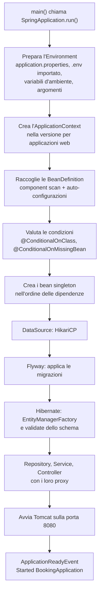

Le righe del log che conosci, al loro posto:
- `HikariPool-1 - Start completed` → F1;
- `Successfully applied 1 migration` / `Schema "public" is up to date` → F2;
- `Tomcat started on port 8080` → G;
- `Started BookingApplication in ... seconds` → H.

Un dettaglio verificato sul nostro backend: Tomcat viene **creato** presto (`Tomcat initialized with port 8080` compare nel log prima di Hikari e Flyway), ma viene **avviato**, cioè apre la porta, solo alla fine (`Tomcat started`). Se un bean fallisce (F1–F4), la porta non si apre mai: l'applicazione non accetta richieste finché non è tutta in piedi. E nel messaggio d'errore leggi la catena delle dipendenze (verifica 02, D3: `entityManagerFactory` → `flyway` → `dataSource`).

### 4.4 Come "vedere" l'avvio e i bean

| Strumento | Cosa mostra | Cosa serve |
|---|---|---|
| Log della fabbrica dei bean: `--logging.level.org.springframework.beans.factory.support.DefaultListableBeanFactory=debug` | Ogni bean nel momento in cui **inizia** a crearlo (`Creating shared instance of singleton bean '...'`), in ordine | Niente. Verificato: il nostro backend, che di nostro ha solo la classe `main`, crea **230** bean singleton |
| `--debug` | Il *Conditions Evaluation Report*: quali auto-configurazioni si sono attivate e perché | Niente |
| Debugger di VS Code | Con un breakpoint nel costruttore o in un `@PostConstruct` di un tuo bean, lo **stack delle chiamate** mostra il ciclo di vita dal vivo (`createBean` → `doCreateBean` → `initializeBean`...); nelle variabili, un bean con `@Transactional` ha una classe come `...$$SpringCGLIB$$0`: è il **proxy** | Un tuo bean |
| Spring Boot Dashboard (estensione già installata) | Le applicazioni in esecuzione; i pannelli *Beans* ed *Endpoint Mappings* | Per i dati dal vivo: Actuator |
| Spring Boot Actuator | `/actuator/beans` (ogni bean, il suo tipo, le sue dipendenze), `/actuator/conditions`, `/actuator/mappings`, `/actuator/startup` (ogni fase dell'avvio con la durata) | Una dipendenza in più; in produzione va esposto solo `health` |
| Java Flight Recorder + JDK Mission Control | L'avvio come **linea del tempo** grafica | Una riga nel `main` e il programma JDK Mission Control |

Nel log con il livello `debug` si vede anche come vengono risolte le dipendenze: la creazione di `flyway` **inizia**, Spring scopre che le serve `dataSource` e crea prima quella; solo dopo arrivano `flywayInitializer` (le migrazioni) ed `entityManagerFactory` (Hibernate).

### 4.2 L'auto-configurazione

Ripasso dalla guida 01 (4.5): Spring Boot contiene classi di configurazione per ogni tecnologia, ognuna con delle condizioni. In Boot 4 sono divise nei moduli della 1.3. Le condizioni principali:

| Condizione | Significato |
|---|---|
| `@ConditionalOnClass` | La libreria è presente |
| `@ConditionalOnMissingBean` | Non hai già definito tu un bean di quel tipo: se lo definisci, Boot si fa da parte |
| `@ConditionalOnProperty` | Una proprietà ha un certo valore |
| `@ConditionalOnWebApplication` | È un'applicazione web |

Per vedere cosa ha deciso: avvio con `--debug` → *Conditions Evaluation Report*.

### 4.3 La configurazione: `@Value` e `@ConfigurationProperties`

Due modi di leggere le proprietà nel codice:

| | `@Value("${booking.hold-minutes}")` | `@ConfigurationProperties(prefix = "booking")` |
|---|---|---|
| Dove | Su un campo o un parametro | Su una classe (o un `record`) con più campi |
| Tipi | Conversione semplice | Conversione completa, anche di `Duration`, liste, oggetti annidati |
| Validazione | No | Sì, con `@Validated` e le annotazioni di Bean Validation |
| Valore mancante | **L'avvio si ferma**: `Could not resolve placeholder` | Il campo resta vuoto (o con il default) |
| Quando usarla | Un valore isolato | Un gruppo di impostazioni: **la scelta consigliata** |

Un `@ConfigurationProperties` come `record` è un'ottima applicazione dei record:

```java
@ConfigurationProperties(prefix = "library")
record LibraryProperties(Duration loanDuration, int maxLoans) {}
```

con `library.loan-duration=14d` e `library.max-loans=3` nel file di configurazione.

Attenzione a una differenza scoperta sul nostro backend (guida 03, 1.6): un segnaposto `${...}` che non si risolve in una **proprietà di Spring Boot** (come `spring.datasource.password`) non ferma l'avvio: il valore resta letterale, e l'errore arriva più avanti.

**I profili** (`application-dev.properties`, attivati con `spring.profiles.active`) permettono configurazioni diverse per ambiente. Noi per ora non li usiamo: la differenza la fanno le variabili d'ambiente (D-018).

---

## Parte 5 — Lo strato web

**Nel progetto:** dal passo 5 (prime API), fino al passo 13.

### 5.1 Tomcat e i thread

Tomcat apre la porta 8080 e, per ogni richiesta, prende un **thread** dal suo pool (200 al massimo, di default) e lo usa dall'inizio alla fine della richiesta. Ci torniamo nella parte 13.

### 5.2 I filtri

Prima ancora di Spring MVC, la richiesta attraversa una **catena di filtri** (`jakarta.servlet.Filter`): oggetti che possono esaminarla, modificarla o **fermarla**. Spring Security è una catena di filtri (parte 9): una richiesta senza permesso viene respinta prima di arrivare a qualsiasi controller.

### 5.3 Il `DispatcherServlet` e il percorso dentro Spring MVC

Il `DispatcherServlet` è il **centralino** (*front controller*): riceve tutte le richieste e decide chi deve rispondere.

```mermaid
flowchart LR
    R["Richiesta HTTP"] --> DS["DispatcherServlet"]
    DS --> HM["HandlerMapping<br/>quale metodo<br/>risponde a questo URL?"]
    HM --> HI["HandlerInterceptor<br/>preHandle"]
    HI --> AR["Argument resolvers<br/>prepara i parametri"]
    AR --> MC["HttpMessageConverter<br/>JSON del corpo → record<br/>(Jackson)"]
    MC --> V["Validazione<br/>@Valid"]
    V --> CM["Il metodo<br/>del controller"]
    CM --> OUT["HttpMessageConverter<br/>valore restituito → JSON"]
    OUT --> RESP["Risposta HTTP"]
```

| Pezzo | Cosa fa |
|---|---|
| `HandlerMapping` | All'avvio legge tutte le `@GetMapping`, `@PostMapping`...; a ogni richiesta trova il metodo giusto per metodo HTTP e URL |
| `HandlerInterceptor` | Come un filtro, ma dentro Spring MVC: sa quale controller verrà chiamato |
| *Argument resolver* | Riempie ogni parametro del metodo: dall'URL, dalla query, dal corpo, dagli header |
| `HttpMessageConverter` | Converte il corpo della richiesta in un oggetto Java, e il risultato in JSON. Per il JSON usa Jackson |

### 5.4 Le annotazioni del controller

| Annotazione | Da dove prende il valore | Esempio |
|---|---|---|
| `@RestController` | — (sulla classe) | Tutti i metodi restituiscono dati, non pagine |
| `@RequestMapping("/api/loans")` | — (sulla classe) | Prefisso comune degli URL |
| `@GetMapping`, `@PostMapping`, `@PutMapping`, `@PatchMapping`, `@DeleteMapping` | Metodo HTTP + URL | `@PostMapping("/{id}/return")` |
| `@PathVariable` | Un pezzo dell'URL | `/api/loans/42` → `42` |
| `@RequestParam` | Un parametro della query | `?date=2026-10-20` |
| `@RequestBody` | Il corpo JSON | → un `record` DTO |
| `@RequestHeader`, `@CookieValue` | Header, cookie | — |
| `@Valid` | — | Valida il parametro (parte 8) |
| `@ResponseStatus` | — | Codice HTTP di default del metodo |
| `ResponseEntity<T>` | — (tipo restituito) | Controllo completo: codice, header, corpo |

```java
@RestController
@RequestMapping("/api/loans")
class LoanController {
    private final LoanService loanService;

    LoanController(LoanService loanService) {
        this.loanService = loanService;
    }

    @PostMapping
    @ResponseStatus(HttpStatus.CREATED)
    LoanResponse borrow(@Valid @RequestBody BorrowRequest request) {
        return loanService.borrow(request);          // no logic here: architettura.md
    }
}

record BorrowRequest(@NotNull Long bookId, @NotNull Long memberId) {}
record LoanResponse(Long loanId, Instant dueAt) {}
```

Regola dell'architettura: **nel controller nessuna logica**. Riceve, valida la forma, chiama il servizio, restituisce.

### 5.5 Jackson 3: Java ↔ JSON

In Spring Boot 4 Jackson è alla versione 3: le classi stanno in **`tools.jackson`** (per esempio `tools.jackson.databind.json.JsonMapper`), le annotazioni come `@JsonProperty` restano in `com.fasterxml.jackson.annotation`. Cose da sapere:
- i **`record`** si convertono senza configurazione: è il motivo per cui sono perfetti come DTO;
- i tipi `java.time` (`Instant`, `LocalDate`) diventano stringhe ISO-8601 (`"2026-10-20T09:00:00Z"`);
- il bean del convertitore lo crea Boot (modulo `spring-boot-jackson`); si personalizza con proprietà `spring.jackson.*` o con un bean dedicato.

### 5.6 Gli errori: `@RestControllerAdvice` e `ProblemDetail`

L'architettura ha deciso: errori nel formato standard **Problem Details** (RFC 9457), con un codice leggibile (`SLOT_NOT_AVAILABLE`) che il frontend traduce in italiano.

| Pezzo | Cosa fa |
|---|---|
| `@RestControllerAdvice` | Una classe che gestisce le eccezioni di **tutti** i controller, in un posto solo |
| `@ExceptionHandler(TipoEccezione.class)` | Un metodo dell'advice: "quando un controller lancia questa eccezione, rispondi così" |
| `ProblemDetail` | La classe di Spring che rappresenta la risposta d'errore standard: `status`, `title`, `detail`, più proprietà nostre come `code` |
| `spring.mvc.problemdetails.enabled=true` | Anche gli errori di Spring MVC stessi (JSON malformato, URL inesistente) escono in questo formato |

Senza un advice, un'eccezione non gestita diventa un `500` generico, e il frontend non sa cosa dire al cliente.

Errori che Spring gestisce da solo, da conoscere:

| Eccezione | Quando | Codice |
|---|---|---|
| `MethodArgumentNotValidException` | Un DTO con `@Valid` non è valido | 400 |
| `HttpMessageNotReadableException` | Il corpo JSON non si può leggere | 400 |
| `NoResourceFoundException` | Nessun metodo per quell'URL | 404 |
| `HttpRequestMethodNotSupportedException` | URL giusto, metodo HTTP sbagliato | 405 |

### 5.7 Il contratto OpenAPI (quando arriveranno le API)

L'architettura prevede il contratto **OpenAPI** generato in automatico (con la libreria *springdoc*): una descrizione di tutte le API, letta dai controller e dai DTO. Il frontend genera i suoi tipi da lì. Sarà una dipendenza nuova, da aggiungere con il primo controller.

---

## Parte 6 — Lo strato di servizio e le transazioni

**Nel progetto:** dal passo 5; centrale nei passi 7–11.

### 6.1 Il ruolo del servizio

Il servizio contiene **le regole del dominio** (un credito si usa dal lotto che scade prima, una cancellazione oltre il preavviso non dà credito) e **decide i confini delle transazioni**. È anche la **porta pubblica del modulo** (D-002): gli altri moduli chiamano il servizio, mai il repository. Con repository ed entità non pubblici, lo garantisce il compilatore (guida 05, 3.3).

### 6.2 `@Transactional`: cosa fa davvero

Una **transazione** è un gruppo di operazioni che riescono **tutte** o **nessuna** (le proprietà ACID: atomicità, consistenza, isolamento, durabilità). Esempio dal progetto: "crea la prenotazione **e** registra il movimento −1 sul lotto". Se la seconda fallisce, la prima non deve restare.

Con `@Transactional` sul metodo del servizio, il proxy (parte 3):
1. chiede al `JpaTransactionManager` di aprire una transazione;
2. il manager prende una connessione da Hikari, la mette in modalità transazione, e la **lega al thread corrente**, insieme a un `EntityManager` (parte 13);
3. il tuo metodo gira: tutti i repository che usa, anche di moduli diversi, trovano **la stessa** connessione legata al thread, quindi lavorano nella **stessa** transazione;
4. alla fine: se il metodo termina normalmente, **flush** (Hibernate scrive le modifiche) e **`commit`**; se lancia un'eccezione, **`rollback`**.

### 6.3 Le opzioni di `@Transactional`

**Quando fa `rollback`: la trappola delle eccezioni controllate.**

| Il metodo lancia... | Di default |
|---|---|
| `RuntimeException` (e sottoclassi) o `Error` | **`rollback`** |
| Un'eccezione **controllata** (`Exception` che non è `RuntimeException`) | **`commit`**! |

Si cambia con `@Transactional(rollbackFor = Exception.class)`. Molti progetti usano solo eccezioni non controllate per il dominio, anche per questo.

**Propagazione: cosa succede se un metodo transazionale ne chiama un altro.**

| Propagazione | Comportamento | Uso |
|---|---|---|
| `REQUIRED` (default) | Se c'è già una transazione, partecipa a quella; altrimenti ne apre una | Quasi sempre |
| `REQUIRES_NEW` | Sospende quella esistente e ne apre una **nuova**, indipendente | Qualcosa che deve restare anche se il resto fallisce (es. un registro di tentativi) |
| `MANDATORY` | Esige una transazione esistente, altrimenti errore | Metodi che non devono mai girare da soli |
| `SUPPORTS`, `NOT_SUPPORTED`, `NEVER`, `NESTED` | Varianti meno usate | — |

Una conseguenza di `REQUIRED`: se un metodo interno lancia un'eccezione, anche se il chiamante la cattura, la transazione comune è ormai **segnata per il rollback**. Al `commit` arriva una `UnexpectedRollbackException`.

**Altre opzioni:**
- `readOnly = true`: per i metodi che leggono soltanto. Hibernate evita il controllo delle modifiche e il flush: più leggero, e dichiara l'intenzione;
- `isolation`: quanto le transazioni contemporanee si vedono a vicenda. Il default è quello del database: per PostgreSQL *Read Committed* (si vedono solo i dati già confermati);
- `timeout`: secondi massimi.

**Dove metterla:** sui metodi pubblici dei **servizi**. Non sui controller; non serve sui repository di Spring Data (i loro metodi sono già transazionali).

### 6.4 Concorrenza: due difese

| Problema | Difesa | Eccezione Spring |
|---|---|---|
| Due clienti prenotano lo stesso orario nello stesso istante | Vincolo nel database (D-013) | `DataIntegrityViolationException` |
| Due persone modificano la stessa prenotazione partendo dalla stessa versione | **Blocco ottimistico**: colonna `version` + `@Version` nell'entità. Hibernate aggiunge `where version = ?` all'`update`; se nel frattempo qualcuno l'ha cambiata, nessuna riga corrisponde | `ObjectOptimisticLockingFailureException` |

Il modello dati prevede già `booking.version` per il secondo caso. "Ottimistico" perché non blocca niente in anticipo: scommette che il conflitto sia raro, e se capita lo rileva.

### 6.5 Cosa **non** fare dentro una transazione

Una transazione tiene occupata una connessione del pool (10 in tutto) e blocca le righe che ha modificato. Quindi deve durare **il meno possibile**:
- niente chiamate a servizi esterni lenti (Stripe, invio email) **dentro** la transazione (guida 03, 1.2; verifica 02, D4);
- le azioni "dopo" si agganciano al `commit` con `@TransactionalEventListener` (2.6).

### 6.6 I lavori programmati

L'architettura prevede due lavori: ogni minuto le prenotazioni con blocco scaduto passano a `EXPIRED`; ogni notte le sedute passate diventano `COMPLETED`.

| Strumento | Cosa fa |
|---|---|
| `@EnableScheduling` | Su una classe di configurazione: attiva la pianificazione |
| `@Scheduled(fixedDelay = ...)` | Esegue il metodo a intervalli |
| `@Scheduled(cron = "0 0 3 * * *", zone = "Europe/Rome")` | Esegue a orari precisi |

Un metodo programmato è un metodo di un bean come gli altri: per la transazione chiama un servizio `@Transactional` (o è transazionale lui stesso, se chiamato dal pianificatore: la chiamata arriva da fuori, quindi passa per il proxy).

---

## Parte 7 — Lo strato di persistenza

**Nel progetto:** adesso (passo 4) e in tutti i passi successivi.

### 7.1 La catena completa

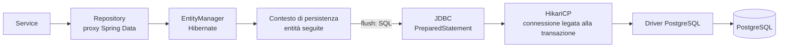

### 7.2 Spring Data JPA

**La gerarchia delle interfacce:**

| Interfaccia | Aggiunge |
|---|---|
| `Repository<T, ID>` | Niente: segna l'interfaccia come repository |
| `CrudRepository` / `ListCrudRepository` | `save`, `findById`, `findAll`, `delete`, `count`, `existsById` |
| `PagingAndSortingRepository` | Pagine e ordinamento |
| `JpaRepository` | Tutto il precedente + `saveAndFlush`, `flush`, operazioni in blocco |

All'avvio Spring crea un proxy dell'interfaccia; dietro c'è una classe di Spring Data, `SimpleJpaRepository`, che implementa i metodi comuni usando l'`EntityManager`.

**Come si scrivono le query:**

| Modo | Esempio | Quando |
|---|---|---|
| Derivata dal nome | `findByEmail(String email)` | Condizioni semplici. Controllata all'avvio (verificato: un errore di battitura blocca l'avvio) |
| `@Query` con JPQL | `@Query("select l from Loan l where l.member.id = :memberId and l.returnedAt is null")` | Condizioni più complesse. JPQL ragiona su **entità e campi Java**, non su tabelle e colonne |
| `@Query(nativeQuery = true)` | SQL vero di PostgreSQL | Funzioni specifiche del database |
| Proiezione su `record` | Un metodo che restituisce `List<LoanSummary>` | Solo alcune colonne, senza entità |
| `@EntityGraph(attributePaths = "member")` | Su un metodo del repository | Carica anche una relazione, contro il problema N+1 |
| `@Modifying` + `@Query` | `update` o `delete` in blocco | Modifiche di massa |
| `Pageable` / `Page<T>` | Un parametro e un tipo restituito | Elenchi lunghi a pagine |

**Cosa fa `save`.** Se l'entità è **nuova** (id `null`), chiama `persist`: inserisce. Altrimenti chiama `merge`: copia lo stato dell'oggetto su quello gestito. Per un'entità già *managed* (caricata nella stessa transazione) `save` non serve: basta modificarla (7.3).

### 7.3 Hibernate e il contesto di persistenza

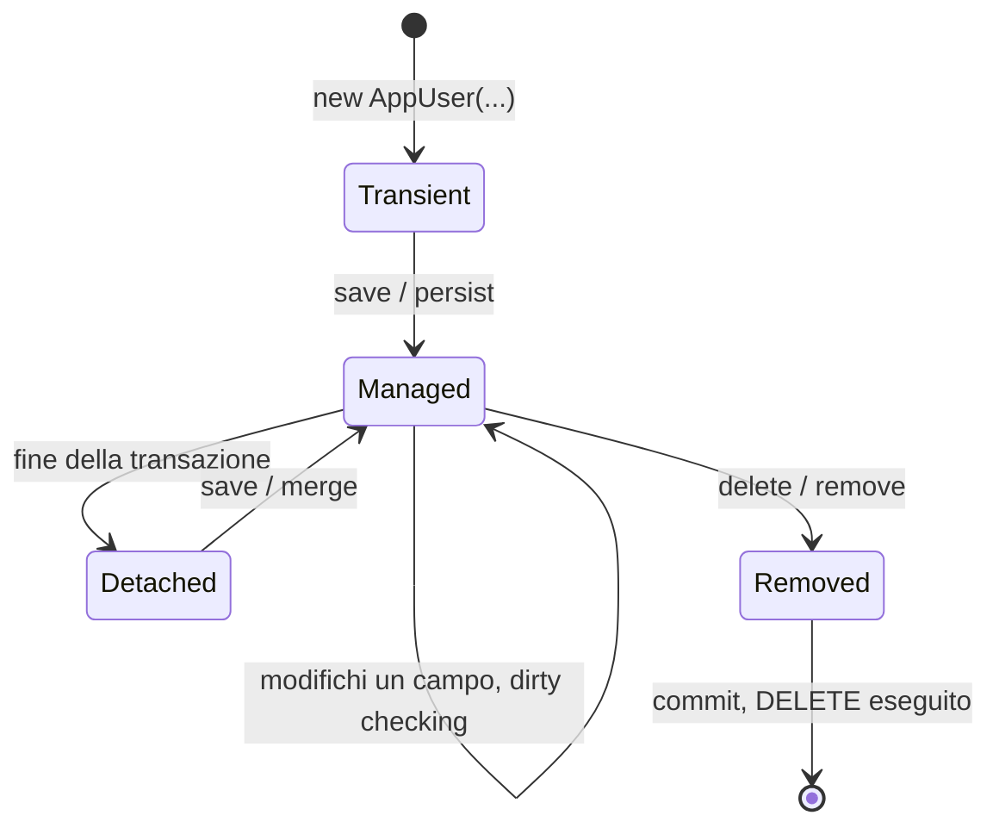

Il **contesto di persistenza** è la "memoria di lavoro" di Hibernate per una transazione:

| Cosa fa | Conseguenza |
|---|---|
| **Cache di primo livello** | Due `findById(1)` nella stessa transazione: **una** query; la seconda restituisce lo **stesso** oggetto |
| **Garanzia di identità** | Dentro la transazione, una riga = un oggetto Java |
| ***Dirty checking*** | Al flush confronta ogni entità con la sua copia iniziale e scrive gli `update` necessari, senza `save` |
| **Flush** | Scrive in SQL le modifiche accumulate. Avviene al `commit` e **prima di una query** che riguarda le tabelle modificate (modalità `AUTO`). Con `IDENTITY` l'`insert` avviene subito (guida 05, 1.2) |

### 7.4 Le relazioni tra entità

| Annotazione | Relazione | Esempio dal modello | Default di caricamento |
|---|---|---|---|
| `@ManyToOne` + `@JoinColumn(name = "customer_id")` | Molte righe di qui → una di là | Molte prenotazioni → un cliente | **EAGER** (da cambiare in LAZY) |
| `@OneToMany(mappedBy = "...")` | Una → molte, lato inverso | Un lotto → molti movimenti | LAZY |
| `@OneToOne` | Una ↔ una | Un cliente ↔ un utente | EAGER |
| `@ManyToMany` | Molte ↔ molte | — | LAZY |

Il caricamento pigro, il proxy, `LazyInitializationException` e il problema N+1 sono spiegati nella guida 05, 1.8.

**`cascade` di JPA e `on delete cascade` del database sono due cose diverse.** `cascade = CascadeType.PERSIST` dice a Hibernate: "quando salvi questo oggetto, salva anche quelli collegati". `on delete cascade` in SQL dice al database: "cancellando questa riga, cancella le righe che la puntano". Il secondo l'abbiamo escluso in V1 apposta (D-021).

### 7.5 La traduzione delle eccezioni

Ogni livello ha le sue eccezioni, e Spring le **traduce** in una gerarchia unica, indipendente dal database: `DataAccessException`.

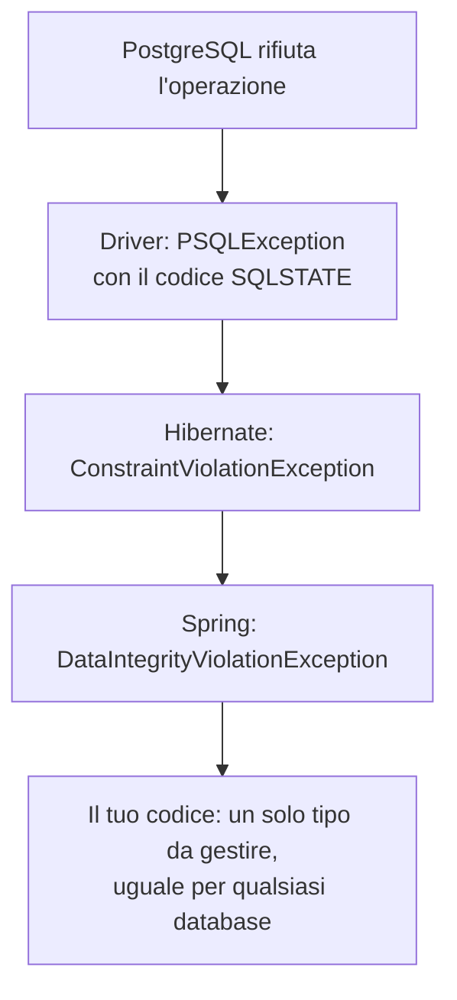

| Eccezione Spring | Quando |
|---|---|
| `DataIntegrityViolationException` | Un vincolo violato (`unique`, `check`, chiave esterna, `not null`). Verificato sul nostro backend |
| `ObjectOptimisticLockingFailureException` | Conflitto di versione (6.4) |
| `CannotAcquireLockException`, `PessimisticLockingFailureException` | Blocchi e attese |
| `DataAccessResourceFailureException` | Il database non si raggiunge |

È il motivo per cui il driver ha scope `runtime` (guida 01, 3.6): non devi mai catturare `PSQLException`.

### 7.6 Sotto Hibernate: JDBC, HikariCP, il driver, Flyway

Riassunto delle guide precedenti:
- **JDBC** è il contratto, il **driver** lo implementa (guida 03, 1.1; verifica 02);
- **HikariCP** presta connessioni brevi: 10 di default, attesa fino a 30 secondi (guida 03, 1.2);
- **Flyway** applica le migrazioni all'avvio, prima di Hibernate (guida 04);
- **`ddl-auto=validate`**: Hibernate controlla, non modifica (guida 03, 1.4).

Per SQL scritto a mano, senza entità, Spring offre **`JdbcClient`** (`org.springframework.jdbc.core.simple.JdbcClient`): usa la stessa connessione e la stessa transazione di JPA.

---

## Parte 8 — La validazione su tre livelli

Nel progetto un dato sbagliato incontra **tre difese**, ognuna con un compito diverso:

| Livello | Strumento | Cosa controlla | Se fallisce |
|---|---|---|---|
| 1. Ingresso (DTO) | Bean Validation: `@Valid` + `@NotNull`, `@NotBlank`, `@Email`, `@Size`, `@Positive`, `@Future`... | La **forma**: campi presenti, formati, lunghezze | 400, con l'elenco dei campi sbagliati |
| 2. Dominio | Value object (`Email`), regole nei servizi | Le **regole**: il preavviso, il credito disponibile, l'orario libero | Un'eccezione di dominio → `ProblemDetail` con un codice |
| 3. Database | Vincoli SQL | Le **invarianti**, anche con richieste contemporanee | `DataIntegrityViolationException` |

Strumenti di Bean Validation (`jakarta.validation`, implementato da Hibernate Validator):
- `@Valid` su un parametro o su un campo: "valida questo oggetto" (anche a cascata, su oggetti annidati);
- `@Validated` (di Spring) su una classe: attiva la validazione dei parametri dei suoi metodi, tramite proxy;
- si possono scrivere **vincoli personalizzati** (un'annotazione + un `ConstraintValidator`).

---

## Parte 9 — La sicurezza (anteprima)

**Nel progetto:** passo 8. Qui solo la mappa, per sapere dove si colloca.

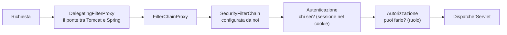

| Concetto | Significato |
|---|---|
| **Autenticazione** | Stabilire **chi sei** (nel nostro caso: codice via email, poi sessione, D-014) |
| **Autorizzazione** | Stabilire **cosa puoi fare** (`CUSTOMER`, `PRACTITIONER`, `ADMIN`) |
| `SecurityFilterChain` | Il bean, dichiarato in una `@Configuration`, che descrive le regole: quali URL sono pubblici, quali richiedono un ruolo |
| `SecurityContextHolder` | Dove Spring tiene l'utente autenticato della richiesta corrente: legato al **thread** (parte 13) |
| `@PreAuthorize("hasRole('PRACTITIONER')")` | Controllo sul singolo metodo, tramite proxy (parte 3) |
| CSRF | Protezione contro richieste fatte "a nome tuo" da altri siti: rilevante proprio perché usiamo un cookie di sessione |

Da Spring Security 6 non esiste più `WebSecurityConfigurerAdapter`: si dichiara la `SecurityFilterChain` come bean (guida 01, 5.1).

---

## Parte 10 — I servizi trasversali

### 10.1 Il logging

- **SLF4J** è il contratto: nel codice usi `org.slf4j.Logger` (`LoggerFactory.getLogger(MiaClasse.class)`);
- **Logback** è l'implementazione, configurata da Spring Boot;
- i livelli, dal più dettagliato: `TRACE`, `DEBUG`, `INFO`, `WARN`, `ERROR`. Si regolano per package: `logging.level.org.hibernate.SQL=debug`;
- si scrive con i segnaposto: `log.info("Booking {} confirmed", bookingId)`, non concatenando stringhe;
- **mai** nei log: password, codici di accesso, dati delle carte, e il meno possibile di dati personali.

### 10.2 Vedere Spring al lavoro: la "lente" dei log

Spring e Hibernate raccontano tutto quello che fanno, se alzi il livello di log dei pacchetti giusti. Senza nessuna dipendenza in più.

| Livello | Cosa mostra |
|---|---|
| `logging.level.org.springframework.orm.jpa.JpaTransactionManager=debug` | Ogni transazione: apertura, partecipazione, `commit`, `rollback` |
| `logging.level.org.hibernate.SQL=debug` | Ogni istruzione SQL inviata al database |
| `logging.level.org.hibernate.orm.jdbc.bind=trace` | I valori dei parametri di ogni istruzione (attenzione: in chiaro, quindi mai in produzione) |
| `logging.level.org.springframework.web.servlet.DispatcherServlet=debug` | Ogni richiesta HTTP: quale metodo la gestisce, con che esito (quando avremo i controller) |
| `logging.level.com.zaxxer.hikari=debug` | Lo stato del pool di connessioni |
| `logging.level.org.springframework.beans.factory.support.DefaultListableBeanFactory=debug` | La creazione dei bean all'avvio (4.4) |

**Dove scriverli.** Nel tuo `.env`, che Spring importa come file di proprietà (D-018): valgono solo sul tuo computer e non finiscono nel repository. Verificato: un livello di log scritto in un file importato funziona. Oppure come argomenti, `-Dlogging.level...=debug`, anche con `.\mvnw.cmd test`.

**L'output reale**, da un test `@DataJpaTest` che salva un utente e lo rilegge (verificato il 2026-10-22), con i rimandi alle sezioni:

```
JpaTransactionManager : Creating new transaction with name [...AppUserRepositoryTest.saveAndRead]: PROPAGATION_REQUIRED  ← il test è @Transactional (11.2)
JpaTransactionManager : Opened new EntityManager [SessionImpl(45020753<open>)] for JPA transaction                        ← il contesto di persistenza (7.3)
TransactionContext    : Began transaction (1) for test class [...]; test method [saveAndRead]
JpaTransactionManager : Found thread-bound EntityManager [SessionImpl(45020753<open>)] for JPA transaction                ← legato al THREAD (13.1)
JpaTransactionManager : Participating in existing transaction                                                             ← save() è transazionale, ma con REQUIRED partecipa (6.3)
org.hibernate.SQL     : insert into app_user (active,email,phone,role) values (?,?,?,?) returning id,created_at          ← IDENTITY: insert subito; @Generated: created_at riletto nella stessa istruzione
jdbc.bind             : binding parameter (1:BOOLEAN) <- [true]                                                           ← active = true dal campo Java
jdbc.bind             : binding parameter (2:VARCHAR) <- [mario@test.it]
jdbc.bind             : binding parameter (3:VARCHAR) <- [null]
jdbc.bind             : binding parameter (4:VARCHAR) <- [CUSTOMER]                                                       ← EnumType.STRING
org.hibernate.SQL     : select au1_0.id, ... from app_user au1_0 where au1_0.email=?                                     ← la query derivata da findByEmail (7.2)
JpaTransactionManager : Initiating transaction rollback                                                                   ← fine del test: rollback (11.2)
JpaTransactionManager : Rolling back JPA transaction on EntityManager [SessionImpl(45020753<open>)]
JpaTransactionManager : Closing JPA EntityManager after transaction
```

Tre cose da notare:
- **lo stesso** `SessionImpl(45020753)` dall'inizio alla fine: un solo contesto di persistenza per tutta la transazione, ritrovato attraverso il thread;
- `created_at` non compare tra le colonne dell'`insert`, ma compare nel `returning`: è `@Generated` che lo esclude e lo rilegge senza una query in più;
- nessun `update` e nessun `commit`: il test annulla tutto.

### 10.3 Configurazione, profili, Actuator

- La configurazione: guida 03 e 4.3 qui sopra;
- **Spring Boot Actuator** (non ancora nel progetto) espone endpoint di stato (`/actuator/health`): utile in produzione per sapere se l'applicazione è viva. Da valutare al passo 14.

---

## Parte 11 — I test

### 11.1 La piramide

| Tipo | Strumenti | Cosa avvia | Velocità | Nel progetto |
|---|---|---|---|---|
| **Unitario** | JUnit 6, AssertJ, Mockito | Niente di Spring: `new` e oggetti finti | Millisecondi | Value object, calcolo degli orari, regole dei crediti |
| ***Slice*** **web** | `@WebMvcTest` + `MockMvc` | Solo lo strato web; i servizi sono finti (`@MockitoBean`) | Secondi | Controller: codici HTTP, JSON, validazione |
| ***Slice*** **JPA** | `@DataJpaTest` + Testcontainers | Solo JPA, Flyway e il database | Secondi | Repository, vincoli (passo 4) |
| **Completo** | `@SpringBootTest` + Testcontainers | Tutta l'applicazione | Più lento | I flussi importanti dall'inizio alla fine |

Tanti test unitari, meno test di integrazione, pochi test completi.

### 11.2 Strumenti da conoscere

| Strumento | Package (Boot 4) | Cosa fa |
|---|---|---|
| `@SpringBootTest` | `org.springframework.boot.test.context` | Avvia l'intera applicazione |
| `@WebMvcTest` | `org.springframework.boot.webmvc.test.autoconfigure` | Solo controller e configurazione web |
| `@DataJpaTest` | `org.springframework.boot.data.jpa.test.autoconfigure` | Solo JPA; ogni test annullato con `rollback` |
| `MockMvc` / `MockMvcTester` | `org.springframework.test.web.servlet` | Simula richieste HTTP senza un server vero |
| `@MockitoBean` | `org.springframework.test.context.bean.override.mockito` | Sostituisce un bean con un oggetto finto di Mockito |
| `@ServiceConnection` | `org.springframework.boot.testcontainers.service.connection` | Connessione presa dal container |

**Attenzione ai tutorial:** `@MockBean`, molto diffusa, **non esiste più** in Spring Boot 4 (verificato: non è nel jar di `spring-boot-test` 4.1.1). Al suo posto c'è `@MockitoBean`, che fa parte di Spring Framework.

**La cache dei contesti.** Avviare Spring per un test costa secondi. Spring riusa lo stesso contesto tra classi di test con **la stessa configurazione**. Ogni combinazione diversa (un `@MockitoBean` in più, una proprietà diversa) crea un contesto nuovo. Conviene che i test si somiglino.

---

## Parte 12 — Tutto insieme: il viaggio di una prenotazione

Il flusso "prenotazione con credito" dell'architettura (passi 7–10), attraverso tutti gli strati. È il progetto **come sarà**, semplificato: i nomi delle classi sono indicativi.

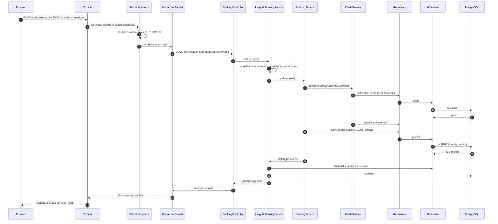

**La strada dell'errore: l'orario è stato preso un istante prima.**

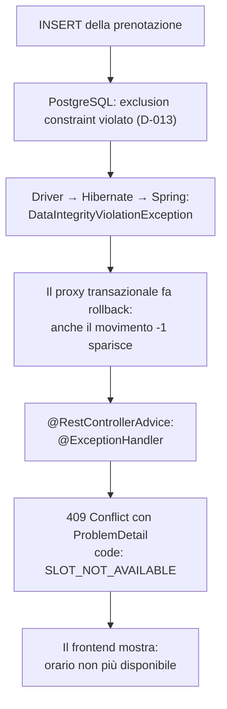

Guarda il punto D: il movimento sul credito e la prenotazione stanno nella **stessa** transazione, anche se li hanno scritti due moduli diversi. Il rollback li annulla **entrambi**: il cliente non perde il credito per una prenotazione fallita. È esattamente ciò che "atomicità" vuol dire.

---

## Parte 13 — Il modello a thread

### 13.1 Un thread per richiesta

Tomcat assegna un thread a ogni richiesta, che la segue **dall'inizio alla fine**. Su questo si appoggiano molti meccanismi di Spring, che "appendono" informazioni al thread con un **`ThreadLocal`**: una variabile che ha un valore **diverso per ogni thread**.

| Cosa è legato al thread | Chi lo gestisce | Conseguenza |
|---|---|---|
| La connessione e l'`EntityManager` della transazione | `TransactionSynchronizationManager` | Tutti i repository chiamati nella transazione usano la stessa connessione (6.2) |
| L'utente autenticato | `SecurityContextHolder` | Ovunque nel codice sai chi sta facendo la richiesta |
| I dati della richiesta HTTP | `RequestContextHolder` | — |
| I dati di contesto dei log (MDC) | SLF4J / Logback | Ogni riga di log può riportare, per esempio, un id della richiesta |

### 13.2 Le conseguenze

- **Cambiare thread fa perdere tutto.** Un metodo `@Async` gira su un altro thread: **non** vede la transazione, né l'utente autenticato, del chiamante. È voluto, ma sorprende.
- **Lo stato condiviso è pericoloso.** I bean sono singleton (2.4) usati da molti thread insieme: niente campi modificabili.
- **Il pool di Tomcat ha un limite** (200 thread). Un thread fermo ad aspettare (il database, Stripe) è un thread che non serve altre richieste.

### 13.3 Vederlo dal vivo: i thread della nostra applicazione

Osservati il 2026-10-22 sul nostro backend acceso (con `jcmd Thread.print`, lo stesso dato che mostra VisualVM nella scheda *Threads*):

| Thread | Quanti | Chi è |
|---|---|---|
| `http-nio-8080-exec-N` | 10 | I **lavoratori di Tomcat**: ognuno serve una richiesta alla volta. A riposo sono in stato `WAITING`. Tomcat ne tiene 10 pronti e ne crea altri, fino a 200, quando le richieste aumentano |
| `http-nio-8080-Acceptor` | 1 | Accetta le nuove connessioni |
| `http-nio-8080-Poller` | 1 | Sorveglia le connessioni aperte e passa ai lavoratori quelle pronte |
| `container-0`, `Catalina-utility-N` | 1 + 2 | Tengono in vita Tomcat e fanno manutenzione |
| `HikariPool-1:housekeeper` | 1 | Manutenzione del pool di connessioni |
| `GC Thread`, `G1 ...` | ~27 | Il *garbage collector* |
| `C1 CompilerThread` | 12 | Il compilatore JIT, che trasforma il bytecode più usato in codice macchina |
| `Reference Handler`, `Finalizer`, `Signal Dispatcher`, `Common-Cleaner`... | — | Servizi interni della JVM |
| `DestroyJavaVM` | 1 | Quel che resta del thread `main` |

Da notare:
- **non c'è un thread `main` al lavoro**: `SpringApplication.run()` è terminato dopo l'avvio. Da quel momento l'applicazione vive sui thread di Tomcat;
- le classi caricate sono circa **12.300**, per un'applicazione che di nostro ha una classe sola: è il peso di Spring, Hibernate, Tomcat e del JDK;
- oggi **nessun proxy CGLIB**: nessuno dei nostri bean ha ancora `@Transactional`. Appariranno con i servizi; i repository di Spring Data saranno invece proxy JDK (`jdk.proxy...$Proxy...`).

Una richiesta verso un URL che non esiste (`/prova`) attraversa davvero Tomcat e il `DispatcherServlet`, e torna con `404` in JSON: `{"timestamp":"...","status":404,"error":"Not Found","path":"/prova"}`. È il modo per far lavorare l'applicazione anche prima di avere dei controller.

### 13.4 I *virtual thread* (Java 21)

Con `spring.threads.virtual.enabled=true` Tomcat usa i **virtual thread** di Java 21: thread leggerissimi, gestiti dalla JVM invece che dal sistema operativo. Se ne possono avere milioni, e un thread in attesa non occupa risorse preziose. Il modello di programmazione resta identico: un thread per richiesta, codice sequenziale. Attenzione però: il **pool di connessioni** resta di 10. Più thread non vuol dire più accessi contemporanei al database. Per il nostro carico non serve, ma è una novità di Java 21 da saper spiegare ai colloqui.

---

## Parte 14 — Prontuario delle annotazioni

| Annotazione | Package | Strato | Cosa fa | Parte |
|---|---|---|---|---|
| `@SpringBootApplication` | `org.springframework.boot.autoconfigure` | Avvio | Configurazione + auto-configurazione + component scan | 4 |
| `@Component`, `@Service`, `@Repository`, `@Controller` | `org.springframework.stereotype` | IoC | Dichiarano un bean | 2.2 |
| `@Configuration`, `@Bean` | `org.springframework.context.annotation` | IoC | Bean definiti con metodi | 2.2 |
| `@Primary`, `@Profile`, `@Scope`, `@Import` | `org.springframework.context.annotation` | IoC | Scelta, ambiente, scope, importazione | 2 |
| `@Autowired`, `@Qualifier`, `@Value` | `org.springframework.beans.factory.annotation` | IoC | Iniezione, scelta, valore di configurazione | 2.3, 4.3 |
| `@ConfigurationProperties` | `org.springframework.boot.context.properties` | Configurazione | Lega un gruppo di proprietà a una classe | 4.3 |
| `@PostConstruct`, `@PreDestroy` | `jakarta.annotation` | IoC | Ciclo di vita | 2.5 |
| `@EventListener` | `org.springframework.context.event` | IoC | Reagisce a un evento | 2.6 |
| `@TransactionalEventListener` | `org.springframework.transaction.event` | Servizio | Reagisce dopo il `commit` | 2.6 |
| `@RestController`, `@RequestMapping`, `@GetMapping`, `@PostMapping`... | `org.springframework.web.bind.annotation` | Web | Controller e URL | 5.4 |
| `@PathVariable`, `@RequestParam`, `@RequestBody`, `@RequestHeader`, `@CookieValue` | `org.springframework.web.bind.annotation` | Web | Parametri dalla richiesta | 5.4 |
| `@ResponseStatus`, `@RestControllerAdvice`, `@ExceptionHandler` | `org.springframework.web.bind.annotation` | Web | Codici ed errori | 5.4, 5.6 |
| `@Valid` | `jakarta.validation` | Validazione | Valida un oggetto | 8 |
| `@NotNull`, `@NotBlank`, `@Email`, `@Size`, `@Positive`... | `jakarta.validation.constraints` | Validazione | Vincoli sui campi | 8 |
| `@Validated` | `org.springframework.validation.annotation` | Validazione | Validazione dei parametri dei metodi | 8 |
| `@Transactional` | `org.springframework.transaction.annotation` | Servizio | Transazione | 6 |
| `@Scheduled`, `@EnableScheduling` | `org.springframework.scheduling.annotation` | Servizio | Lavori programmati | 6.6 |
| `@Async`, `@EnableAsync` | `org.springframework.scheduling.annotation` | Servizio | Esecuzione su un altro thread | 13 |
| `@Entity`, `@Table`, `@Id`, `@GeneratedValue`, `@Column`, `@Enumerated`, `@Version` | `jakarta.persistence` | Persistenza | Mapping | 7, guida 05 |
| `@ManyToOne`, `@OneToMany`, `@OneToOne`, `@JoinColumn` | `jakarta.persistence` | Persistenza | Relazioni | 7.4 |
| `@Embeddable`, `@Embedded`, `@Converter` | `jakarta.persistence` | Persistenza | Gruppi di colonne, conversioni | guida 05 |
| `@Generated` | `org.hibernate.annotations` | Persistenza | Valore generato dal database | guida 05 |
| `@Query`, `@Modifying`, `@EntityGraph` | `org.springframework.data.jpa.repository` | Persistenza | Query personalizzate | 7.2 |
| `@JsonProperty`, `@JsonIgnore` | `com.fasterxml.jackson.annotation` | Web | Controllo del JSON | 5.5 |
| `@PreAuthorize` | `org.springframework.security.access.prepost` | Sicurezza | Permessi sul metodo | 9 |
| `@SpringBootTest` | `org.springframework.boot.test.context` | Test | Applicazione intera | 11 |
| `@WebMvcTest` | `org.springframework.boot.webmvc.test.autoconfigure` | Test | Solo web | 11 |
| `@DataJpaTest` | `org.springframework.boot.data.jpa.test.autoconfigure` | Test | Solo JPA | 11 |
| `@MockitoBean` | `org.springframework.test.context.bean.override.mockito` | Test | Bean finto | 11 |
| `@Testcontainers`, `@Container` | `org.testcontainers.junit.jupiter` | Test | Container Docker | 11 |
| `@ServiceConnection` | `org.springframework.boot.testcontainers.service.connection` | Test | Connessione dal container | 11 |
| `@Test`, `@BeforeEach`, `@Nested`, `@DisplayName` | `org.junit.jupiter.api` | Test | JUnit | 11 |

---

## Parte 15 — Domande da colloquio

1. Cos'è l'inversione del controllo? Che differenza c'è tra `BeanFactory` e `ApplicationContext`?
2. Iniezione tramite costruttore o tramite campo? Perché?
3. Cos'è un bean singleton? Che conseguenze ha sullo stato dei campi?
4. Come funziona `@Transactional` sotto il cofano? Cos'è un proxy?
5. Perché `@Transactional` non funziona quando un metodo chiama un altro metodo della stessa classe?
6. Una transazione fa `rollback` se il metodo lancia un'eccezione controllata?
7. Differenza tra propagazione `REQUIRED` e `REQUIRES_NEW`?
8. Descrivi il percorso di una richiesta HTTP in Spring MVC, dal `DispatcherServlet` al JSON di risposta.
9. Come gestisci gli errori in modo centralizzato in un'API REST?
10. Cos'è il contesto di persistenza? Cos'è il *dirty checking*? Quando avviene il flush?
11. Cosa fa la traduzione delle eccezioni di Spring, e perché è utile?
12. Blocco ottimistico: cos'è, come si implementa, quando conviene?
13. `@Value` o `@ConfigurationProperties`?
14. Che differenza c'è tra `@WebMvcTest`, `@DataJpaTest` e `@SpringBootTest`? Cosa ha sostituito `@MockBean`?
15. Cosa succede all'avvio di un'applicazione Spring Boot, in ordine?
16. Cos'è un `ThreadLocal` e dove lo usa Spring? Cosa cambia con `@Async`? E con i virtual thread?
17. Perché inviare un'email di conferma con `@TransactionalEventListener` invece che dentro il metodo transazionale?

---

## Parte 16 — Documentazione ufficiale

- Spring Framework, riferimento completo: https://docs.spring.io/spring-framework/reference/
  - Il contenitore IoC: https://docs.spring.io/spring-framework/reference/core/beans.html
  - AOP e proxy: https://docs.spring.io/spring-framework/reference/core/aop.html
  - Transazioni: https://docs.spring.io/spring-framework/reference/data-access/transaction.html
  - Spring MVC: https://docs.spring.io/spring-framework/reference/web/webmvc.html
  - Gestione degli errori e `ProblemDetail`: https://docs.spring.io/spring-framework/reference/web/webmvc/mvc-ann-rest-exceptions.html
  - Test: https://docs.spring.io/spring-framework/reference/testing.html
- Spring Boot, riferimento: https://docs.spring.io/spring-boot/reference/
- Spring Data JPA: https://docs.spring.io/spring-data/jpa/reference/
- Spring Security: https://docs.spring.io/spring-security/reference/
- Hibernate ORM, guida utente: https://docs.jboss.org/hibernate/orm/7.0/userguide/html_single/Hibernate_User_Guide.html
- Jakarta EE, specifiche (Persistence, Validation, Servlet): https://jakarta.ee/specifications/
- Mermaid, per leggere e modificare i diagrammi: https://mermaid.js.org/
