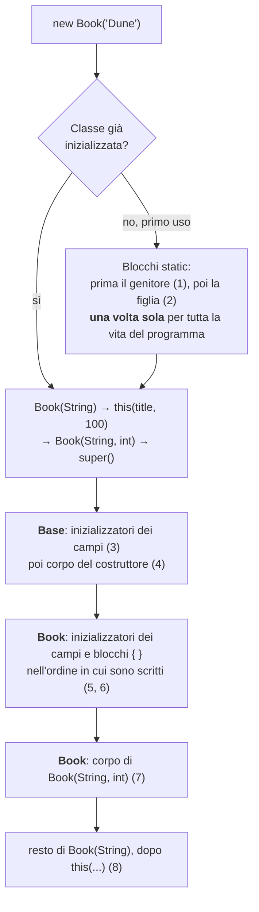
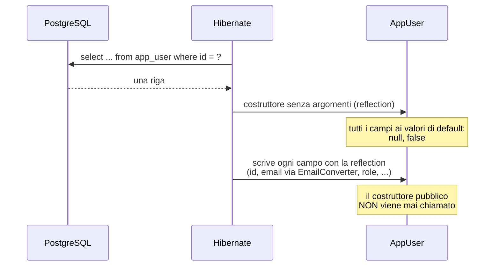
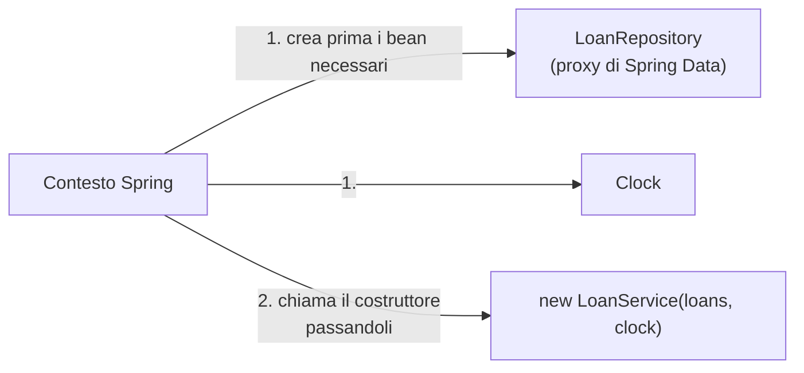
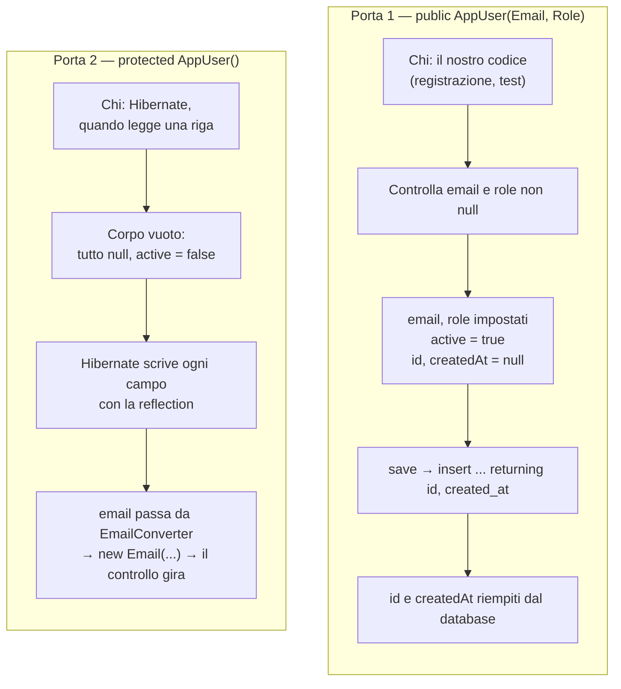

# L'universo dei costruttori — guida di studio

Questa guida nasce da `AppUser`. Ci sono voluti tre tentativi per arrivare ai due costruttori giusti (passo 04, errore 7), e dietro c'è un intero pezzo di Java che conviene conoscere a fondo, anche perché ai colloqui torna spesso.

Contiene:
- **le parti 1–5**: come funziona un costruttore in Java, dal `new` all'ordine esatto in cui succedono le cose;
- **le parti 6–8**: come si progetta un costruttore (visibilità, validazione, alternative come le *static factory* e il *builder*);
- **le parti 9–10**: i costruttori dei `record` e degli `enum`;
- **la parte 11**: chi chiama i costruttori al posto tuo (Hibernate, Spring, Jackson);
- **la parte 12**: il nostro `AppUser` riletto con questi occhi;
- **le parti 13–15**: trappole con i messaggi d'errore veri, domande da colloquio, documentazione.

Gli esempi usano la **biblioteca**, come la guida 05: libri, soci, prestiti. Il codice del progetto lo scrivi tu.

**Tutto quello che la guida dà per vero è stato verificato** il 2026-10-28 con il JDK 21 del progetto (Temurin 21.0.12) e, per Hibernate, con la versione 7.4. I messaggi d'errore sono copiati dal compilatore. Dove un comportamento viene dalla documentazione e non da una prova, è detto.

---

## Indice

1. [Cos'è un costruttore, e cosa fa `new`](#parte-1--cosè-un-costruttore-e-cosa-fa-new)
2. [Il costruttore di default, e quando sparisce](#parte-2--il-costruttore-di-default-e-quando-sparisce)
3. [Più costruttori: `this(...)` e `super(...)`](#parte-3--più-costruttori-this-e-super)
4. [L'ordine esatto dell'inizializzazione](#parte-4--lordine-esatto-dellinizializzazione)
5. [I campi `final` e l'assegnazione definita](#parte-5--i-campi-final-e-lassegnazione-definita)
6. [La visibilità dei costruttori](#parte-6--la-visibilità-dei-costruttori)
7. [Il costruttore come guardiano](#parte-7--il-costruttore-come-guardiano)
8. [Alternative al `new`: static factory e builder](#parte-8--alternative-al-new-static-factory-e-builder)
9. [I costruttori dei `record`](#parte-9--i-costruttori-dei-record)
10. [I costruttori degli `enum`](#parte-10--i-costruttori-degli-enum)
11. [Chi chiama i costruttori al posto tuo](#parte-11--chi-chiama-i-costruttori-al-posto-tuo)
12. [Il nostro `AppUser`, riletto](#parte-12--il-nostro-appuser-riletto)
13. [Trappole e messaggi d'errore](#parte-13--trappole-e-messaggi-derrore)
14. [Domande da colloquio](#domande-da-colloquio)
15. [Documentazione ufficiale](#documentazione-ufficiale)

---

## Parte 1 — Cos'è un costruttore, e cosa fa `new`

### 1.1 Un costruttore non è un metodo

Sembra un metodo, ma ha regole sue:

| | Metodo | Costruttore |
|---|---|---|
| Nome | Qualsiasi | **Uguale alla classe** |
| Tipo di ritorno | Sì (anche `void`) | **Nessuno**, nemmeno `void` |
| Si eredita? | Sì | **No**: ogni classe dichiara i suoi |
| Si può sovrascrivere (`@Override`)? | Sì | **No** |
| Chi lo chiama | Chiunque abbia un riferimento all'oggetto | Solo `new`, `this(...)`, `super(...)` (e la *reflection*, parte 11) |
| Quando | In qualunque momento | **Una volta sola**, alla nascita dell'oggetto |

Se scrivi `public void Book() { }`, con il `void`, hai scritto un **metodo** che per caso si chiama come la classe. Il compilatore lo accetta, e il costruttore non c'è.

### 1.2 Cosa succede con `new Book("Dune")`

Il costruttore **non crea** l'oggetto: lo **completa**. La creazione la fa la JVM, prima:

```
new Book("Dune")
 │
 ├─ 1. la JVM riserva la memoria per un Book
 ├─ 2. ogni campo riceve il suo valore di default (tabella sotto)
 ├─ 3. viene eseguito il costruttore (con tutta la catena della parte 4)
 └─ 4. new restituisce il riferimento all'oggetto, ora pronto
```

Questi sono i valori di default del punto 2, che vale per i **campi**, non per le variabili locali:

| Tipo del campo | Valore prima di ogni inizializzazione |
|---|---|
| `int`, `long`, `short`, `byte` | `0` |
| `double`, `float` | `0.0` |
| `boolean` | `false` |
| `char` | `'\u0000'` |
| Qualsiasi oggetto (`String`, `Long`, `Email`...) | `null` |

Ne segue una cosa importante: **un oggetto ha sempre un valore in ogni campo**, anche se il costruttore non li tocca. Il `boolean active` di un `AppUser` appena nato vale `false` finché qualcuno non scrive `true`. È proprio ciò che succede quando lo crea Hibernate (parte 12).

Se il costruttore lancia un'eccezione, `new` non restituisce niente: **l'oggetto non esiste** per il programma. Su questo si basa la parte 7.

---

## Parte 2 — Il costruttore di default, e quando sparisce

### 2.1 La regola

Se una classe **non dichiara nessun costruttore**, il compilatore ne aggiunge uno senza argomenti e con il corpo vuoto: il **costruttore di default**. Ha la **stessa visibilità della classe**. Verificato con `javap`, che mostra cosa c'è davvero nel `.class`:

```java
public class Pub { }      // →   public Pub();
class Pkg { }             // →   Pkg();          (package-private, come la classe)
```

### 2.2 La trappola: appena ne scrivi uno, il default sparisce

Il default esiste **solo** se non ne hai scritto nessuno. Basta un costruttore con argomenti e il compilatore non aggiunge più niente:

```java
class Member {
    Member(String name) { }
}

new Member();   // error: constructor Member in class Member cannot be applied to given types;
```

È esattamente l'errore 7 del passo 04. Su `AppUser` hai aggiunto `AppUser(email, role)` e tolto quello vuoto. Il compilatore non si lamenta, perché nel nostro codice nessuno scrive `new AppUser()`. A chiamarlo è **Hibernate, a runtime**, ed è lì che il problema esplode (parte 11).

**Regola pratica:** se una classe ha bisogno anche del costruttore senza argomenti, **scrivilo**, e non contare sul default. Scriverlo rende visibile che serve, e a chi.

---

## Parte 3 — Più costruttori: `this(...)` e `super(...)`

### 3.1 Overloading

Una classe può avere più costruttori, purché i parametri siano diversi per numero o tipo:

```java
class Book {
    Book(String title, int pages) { ... }
    Book(String title)            { ... }   // per esempio: pagine ancora sconosciute
}
```

### 3.2 `this(...)`: un costruttore ne chiama un altro della stessa classe

Per non ripetere la logica, i costruttori "comodi" **delegano** a quello completo:

```java
Book(String title) {
    this(title, 100);       // delega al costruttore completo
    // eventuale codice in più, che parte DOPO il costruttore completo
}
```

Così le regole (controlli, valori iniziali) stanno in **un posto solo**, cioè nel costruttore completo. Gli altri si limitano a fornire dei valori.

### 3.3 `super(...)`: il costruttore chiama quello del genitore

Ogni costruttore, come **prima cosa**, chiama un costruttore della classe genitore. Se non lo scrivi, il compilatore aggiunge `super()` da solo, senza argomenti. Anche quando non scrivi `extends` c'è un genitore: `Object`.

Da qui viene un altro errore classico. Se il genitore **non ha** un costruttore senza argomenti, il `super()` implicito non compila:

```java
class Parent { Parent(String s) { } }
class Child extends Parent { Child() { } }
// error: constructor Parent in class Parent cannot be applied to given types;
```

La soluzione è chiamare esplicitamente `super("qualcosa")`.

### 3.4 La regola della prima riga (Java 21)

In Java 21 `this(...)` e `super(...)`, se ci sono, devono essere **la prima istruzione** del costruttore. Un controllo messo prima non compila:

```java
StmtBeforeSuper(String s) {
    Objects.requireNonNull(s);
    super(s);       // error: call to super must be first statement in constructor
}
```

> **Java moderno.** Da Java 25 questa regola si allenta (*Flexible Constructor Bodies*, JEP 513): prima di `super(...)` si possono scrivere istruzioni che non usano `this`, per esempio i controlli sugli argomenti. Il progetto usa Java 21, quindi da noi la regola vale ancora. Non è stato provato qui, perché non abbiamo un JDK 25.

---

## Parte 4 — L'ordine esatto dell'inizializzazione

Questa è la parte che ai colloqui separa chi ha capito da chi ha memorizzato.

### 4.1 L'esperimento

Due classi, con un `log` in ogni punto in cui Java esegue qualcosa:

```java
class Base {
    static { log("1. Base: blocco static"); }
    protected String label = log("3. Base: inizializzatore del campo label");
    Base() {
        log("4. Base: corpo del costruttore");
        describe();                                   // ← attenzione a questa riga (4.3)
    }
    void describe() { ... }
}

class Book extends Base {
    static { log("2. Book: blocco static"); }
    private String title = log("5. Book: inizializzatore del campo title");
    private final int pages;
    { log("6. Book: blocco di istanza { }"); }
    Book(String title, int pages) {
        super();
        log("7. Book: corpo del costruttore");
        this.title = title; this.pages = pages;
    }
    Book(String title) { this(title, 100); log("8. Book(String): dopo this(...)"); }
    @Override void describe() { log("Book.describe chiamato da Base: title=" + title + ", pages=" + pages); }
}

new Book("Dune");
new Book("Emma", 300);
```

L'output vero, sul JDK 21:

```
--- primo new
1. Base: blocco static
2. Book: blocco static
3. Base: inizializzatore del campo label
4. Base: corpo del costruttore
   Book.describe chiamato da Base: title=null, pages=0
5. Book: inizializzatore del campo title
6. Book: blocco di istanza { }
7. Book: corpo del costruttore
8. Book(String): dopo this(...)
--- secondo new (i blocchi static non si ripetono)
3. Base: inizializzatore del campo label
4. Base: corpo del costruttore
   Book.describe chiamato da Base: title=null, pages=0
5. Book: inizializzatore del campo title
6. Book: blocco di istanza { }
7. Book: corpo del costruttore
```

### 4.2 Le regole che l'output dimostra



1. **I blocchi `static`** girano una sola volta, al primo uso della classe, e il genitore viene prima della figlia. Al secondo `new` non ricompaiono.
2. **Si costruisce dall'alto verso il basso.** Prima tutta la parte `Base` (campi e costruttore), poi la parte `Book`. Un figlio non può esistere prima del genitore.
3. **Gli inizializzatori dei campi e i blocchi `{ }`** di una classe girano dopo il `super(...)` e prima del corpo del costruttore, **nell'ordine in cui sono scritti** nel file.
4. **Con `this(...)`** gli inizializzatori girano **una sola volta**, dentro il costruttore che chiama `super(...)`. Il costruttore che ha delegato riprende alla fine (8).

Per questo un valore iniziale scritto sulla dichiarazione del campo (`private boolean active = true;`) vale **per ogni costruttore**: Java lo inserisce in tutti i costruttori che chiamano `super(...)`.

### 4.3 La trappola: un metodo sovrascrivibile chiamato dal costruttore

Guarda la riga sotto il punto 4: il costruttore di `Base` chiama `describe()`. Il metodo è sovrascritto in `Book`, quindi gira **la versione di `Book`**, quando la parte `Book` dell'oggetto **non è ancora stata costruita**:

```
Book.describe chiamato da Base: title=null, pages=0
```

`title` e `pages` hanno ancora i valori di default della parte 1, anche se `pages` è `final`. Il campo `final` viene "visto" due volte con due valori diversi, cosa che normalmente si crede impossibile.

**Regola:** un costruttore non chiama metodi che una sottoclasse può sovrascrivere. Può chiamare quelli `private`, `static` o `final`.

---

## Parte 5 — I campi `final` e l'assegnazione definita

Un campo `final` deve ricevere un valore **esattamente una volta**, in **ogni** percorso del costruttore (o sulla dichiarazione). Il compilatore lo controlla percorso per percorso:

```java
class FinalUnassigned {
    private final int pages;
    FinalUnassigned(boolean b) { if (b) pages = 1; }
    // error: variable pages might not have been initialized
}
```

I campi `final` sono il modo in cui Java garantisce l'**immutabilità**: dopo il costruttore, niente può cambiarli. È la base dei value object (`Email`) e dei bean di Spring (parte 11).

È anche il motivo per cui **un'entità JPA non può avere campi `final`** (guida 05, 1.5): Hibernate li riempie **dopo** il costruttore. Lo vedrai nella parte 12.

---

## Parte 6 — La visibilità dei costruttori

La visibilità di un costruttore decide **chi può creare** l'oggetto.

| Visibilità | Chi può scrivere `new` | Uso tipico |
|---|---|---|
| `public` | Tutti | Il modo normale di creare l'oggetto |
| `protected` | Lo **stesso package** e le **sottoclassi** | Il costruttore per JPA; le classi astratte |
| *(nessuna)*: package-private | Solo lo stesso package | Oggetti interni a un modulo |
| `private` | Solo la classe stessa | Classi di utilità (solo metodi `static`), *static factory* (parte 8), singleton |

**Il dettaglio che sorprende: `protected` include il package.** Non vuol dire "solo le sottoclassi". Nel package `auth`, qualunque classe può scrivere `new AppUser()` anche se il costruttore è `protected`. `protected` ferma solo il codice degli **altri package**: per esempio un futuro servizio nel modulo `customer` non potrà creare un `AppUser` vuoto. Basta, perché il package è il confine del modulo (D-002).

Un costruttore `private` ha un effetto che a volte si cerca apposta: **la classe non si può estendere**. Il costruttore della sottoclasse dovrebbe chiamare `super()`, e non può.

---

## Parte 7 — Il costruttore come guardiano

### 7.1 Gli invarianti

Un **invariante** è una regola che deve valere per **tutta la vita** di un oggetto: "un socio ha sempre un codice tessera", "un libro ha almeno una pagina". Il costruttore è il punto ideale per garantirlo, per due motivi:
- è l'**unica porta d'ingresso**: ogni oggetto ci passa (nel codice nostro; Hibernate è un caso a parte, parte 12);
- se lancia un'eccezione, **l'oggetto non esiste** (1.2). Non c'è nessun oggetto "a metà" da gestire dopo.

Si chiama ***fail fast***: l'errore arriva subito, vicino alla causa, e non tre passaggi dopo quando il database rifiuta la riga.

```java
class Loan {
    private final Member member;
    private final Book book;

    Loan(Member member, Book book) {
        this.member = Objects.requireNonNull(member, "member must not be null");
        this.book   = Objects.requireNonNull(book, "book must not be null");
    }
}
```

`Objects.requireNonNull` restituisce il valore stesso: per questo il controllo e l'assegnazione stanno sulla stessa riga.

### 7.2 Quale eccezione

La convenzione del JDK:

| Problema | Eccezione |
|---|---|
| Un argomento è `null` e non dovrebbe esserlo | `NullPointerException` (con `Objects.requireNonNull`) |
| Un argomento c'è, ma il valore non va bene (vuoto, negativo, formato sbagliato) | `IllegalArgumentException` |
| L'oggetto è in uno stato in cui l'operazione non ha senso (non nel costruttore: nei metodi) | `IllegalStateException` |

### 7.3 Cosa un costruttore non deve fare

- **Lavoro pesante o lento:** niente rete, file o database. Chi scrive `new` si aspetta che sia immediato, e un costruttore non si può "riprovare".
- **Far uscire `this`** prima di aver finito, per esempio registrando l'oggetto in una lista globale o passandolo a un altro thread. Chi lo riceve vede un oggetto incompleto, come nella 4.3. Da Java 21 il compilatore lo segnala, se lo chiedi con `-Xlint:this-escape`. Verificato:
  ```
  warning: [this-escape] possible 'this' escape before subclass is fully initialized
  ```
- **Chiamare metodi sovrascrivibili** (4.3).

---

## Parte 8 — Alternative al `new`: static factory e builder

### 8.1 Le *static factory*

Una ***static factory*** è un metodo `static` che crea e restituisce l'oggetto al posto di `new`. Ne usi già tante:

| Nel JDK | Cosa mostra |
|---|---|
| `List.of(a, b)`, `Optional.of(x)` | Può restituire una classe interna, che il chiamante non conosce |
| `Instant.now()`, `LocalDate.of(2026, 10, 28)` | **Il nome** dice cosa crei |
| `Integer.valueOf(42)` | Può **riusare** un oggetto già creato (gli interi da -128 a 127 sono in una cache) |
| `Optional.empty()` | Può restituire sempre la stessa istanza |

Il vantaggio più grande, nel codice di dominio, è il **nome**. Due costruttori con gli stessi tipi di parametri non possono convivere; due metodi con nomi diversi sì:

```java
class Member {
    private Member(CardCode card, MemberType type) { ... }   // privato: si passa dalle factory

    static Member student(CardCode card)  { return new Member(card, MemberType.STUDENT); }
    static Member staff(CardCode card)    { return new Member(card, MemberType.STAFF); }
}

Member m = Member.student(card);   // si legge come una frase del dominio
```

Il libro di riferimento è *Effective Java* di Joshua Bloch: l'item 1 è proprio "considera le static factory al posto dei costruttori". È una citazione che ai colloqui fa buona impressione.

### 8.2 Il *builder*

Quando i parametri sono tanti, e molti facoltativi, i costruttori si moltiplicano. È il problema dei ***telescoping constructors***: `Book(title)`, `Book(title, pages)`, `Book(title, pages, isbn)`... E chi legge `new Book("Dune", 412, null, true, false)` non capisce cosa siano `true` e `false`.

Il ***builder*** risolve con un oggetto di appoggio a cui si danno i valori **per nome**:

```java
Book book = Book.builder()
        .title("Dune")
        .pages(412)
        .rare(true)
        .build();            // qui avvengono i controlli e nasce il Book
```

Molti progetti lo generano con **Lombok** (`@Builder`). Il nostro non usa Lombok, e per ora non serve.

### 8.3 Quale scegliere

| Situazione | Strumento |
|---|---|
| Pochi parametri obbligatori, un solo modo di creare | **Costruttore** |
| Modi di creare diversi che meritano un nome, oppure cache e riuso | **Static factory** |
| Molti parametri, soprattutto facoltativi | **Builder** |

Per `AppUser` il costruttore basta. Una static factory come `newCustomer(email)` diventerebbe interessante se ogni ruolo avesse regole di creazione diverse: ci si potrà pensare al passo 8 (registrazione) e al passo 13 (amministratore).

---

## Parte 9 — I costruttori dei `record`

### 9.1 Cosa genera il compilatore

Con un `record` dichiari solo i **componenti**, e il compilatore genera il resto. Verificato con `javap`:

```java
record Loan(String code, int days) { Loan { } }
```
```
final class Loan extends java.lang.Record {
  private final java.lang.String code;      // campi privati e final
  private final int days;
  Loan(java.lang.String, int);              // il costruttore CANONICO
  public java.lang.String code();           // gli accessor (senza "get")
  public int days();
  public final boolean equals(java.lang.Object);
  public final int hashCode();
  public final java.lang.String toString();
}
```

Il **costruttore canonico** è quello che riceve **tutti i componenti, nell'ordine**. C'è sempre: o lo scrivi tu, o lo genera il compilatore.

### 9.2 Tre modi di scrivere il canonico

| Forma | Come appare | Quando |
|---|---|---|
| **Implicita** | Non scrivi niente | Nessun controllo da fare |
| **Esplicita** | `Loan(String code, int days) { ...; this.code = code; this.days = days; }` | Raramente: devi assegnare **tu** ogni campo |
| **Compatta** | `Loan { ... }` | Controllare e normalizzare: è la forma pensata per questo |

Nella forma **compatta**:
- i parametri non si ripetono: esistono già, con i nomi dei componenti;
- puoi **riassegnare i parametri** (`code = code.strip();`);
- alla fine il compilatore assegna da solo i campi con i valori **finali** dei parametri;
- **non** puoi assegnare i campi tu. Verificato:
  ```java
  record CompactAssign(String value) { CompactAssign { this.value = value.strip(); } }
  // error: cannot assign a value to final variable value
  ```

`Email` oggi usa la forma esplicita. Funziona, ed è corretta. La compatta dice la stessa cosa con meno codice, ed è quella che un intervistatore si aspetta di vedere in un value object.

### 9.3 La regola di visibilità

Il canonico deve essere **almeno visibile quanto il record**. Un `public record` con un canonico senza modificatore non compila. Verificato:

```java
public record Isbn(String value) { Isbn { } }
// error: invalid canonical constructor in record Isbn
//   (attempting to assign stronger access privileges; was public)
```

Per questo, nell'esempio della guida, il costruttore compatto di `PostalCode` è `public`.

### 9.4 Gli altri costruttori devono delegare

Un record può avere costruttori **non canonici** (con parametri diversi), ma la loro prima istruzione deve essere `this(...)` verso un altro costruttore. Alla fine si arriva sempre al canonico, così i controlli non si possono saltare. Verificato:

```java
record NonCanonical(String code, int copies) {
    NonCanonical(String code) { System.out.println("x"); }
}
// error: constructor is not canonical, so its first statement must invoke another constructor of class NonCanonical

// corretto:
record Copies(String code, int copies) {
    Copies(String code) { this(code, 1); }
}
```

### 9.5 Campi `static` e factory nei record

Un record **non** può avere altri campi d'istanza oltre ai componenti, ma **può** avere campi e metodi `static`. È lì che va un `Pattern` compilato una volta sola, o una static factory come `Isbn.of(text)`.

---

## Parte 10 — I costruttori degli `enum`

Anche un `enum` può avere campi e un costruttore. Ogni costante è **una chiamata al costruttore**, fatta una volta sola quando la classe viene caricata:

```java
enum LoanType {
    STANDARD(30),          // ← new LoanType(30), eseguito una volta all'avvio
    SHORT(7),
    REFERENCE(0);          // consultazione in sede

    private final int days;

    LoanType(int days) {   // implicitamente private
        this.days = days;
    }

    int days() { return days; }
}
```

Le regole:
- il costruttore di un enum è **sempre privato**: nessuno, fuori dall'enum, può creare una costante nuova. Scrivere `public` è un errore. Verificato:
  ```
  error: modifier public not allowed here
  ```
- per questo un enum è un **insieme chiuso**, ed è il motivo per cui `Role` è un enum.

**Per il nostro progetto:** se un giorno servisse un'etichetta in italiano per ogni ruolo, tipo "Cliente" o "Posturologo", andrebbe nel **frontend**, non qui: l'interfaccia è un'altra responsabilità.

---

## Parte 11 — Chi chiama i costruttori al posto tuo

Nel codice di tutti i giorni scrivi `new`. Ma tre attori del progetto creano oggetti **senza** `new`, con la ***reflection***, cioè l'API di Java che ispeziona le classi a runtime e chiama costruttori e campi per nome (`Class.getDeclaredConstructor().newInstance()`). Ognuno ha le sue regole.

### 11.1 Hibernate: il costruttore vuoto, poi i campi

Quando legge una riga, Hibernate fa così:



Le regole che ne seguono (specifica Jakarta Persistence, sezione 2.1):
- **serve un costruttore senza argomenti, `public` o `protected`**;
- la classe e i metodi **non `final`**, perché Hibernate crea **sottoclassi** proxy per il lazy loading (guida 05, 1.8). Il costruttore del proxy deve poter chiamare `super()`: è un'altra ragione per non renderlo `private`;
- i campi **non `final`**, perché vengono scritti dopo il costruttore.

**Cosa succede se manca il costruttore senza argomenti.** Verificato su Hibernate 7.4:
- all'avvio c'è solo una riga `INFO`, che si perde facilmente nel log:
  ```
  HHH000182: No default (no-argument) constructor for class [com.posturestudio.booking.auth.AppUser] (class must be instantiated by Interceptor)
  ```
- l'errore vero arriva quando Hibernate deve **creare** un `AppUser` da una riga:
  ```
  org.hibernate.InstantiationException: No default constructor for entity 'com.posturestudio.booking.auth.AppUser'
  ```

E un test può non accorgersene. In un test `@DataJpaTest` che fa `save` e poi `findById` **nella stessa transazione**, `findById` restituisce l'oggetto già presente nel **contesto di persistenza** (guida 05, 1.1) senza leggere dal database. Quindi il costruttore vuoto non viene mai usato. Per leggere davvero serve svuotare il contesto: `flush()` (scrivi tutto) e `clear()` (dimentica tutto) con `TestEntityManager`. È un buon caso da aggiungere al test.

### 11.2 Spring: l'iniezione dal costruttore

Per i bean (repository, servizi, controller), Spring crea l'oggetto chiamando il **costruttore** e passandogli gli altri bean di cui ha bisogno. Si chiama ***constructor injection***:

```java
@Service
class LoanService {
    private final LoanRepository loans;        // final: non cambierà mai
    private final Clock clock;

    LoanService(LoanRepository loans, Clock clock) {   // un solo costruttore: Spring usa questo
        this.loans = loans;
        this.clock = clock;
    }
}
```



Dalla documentazione di Spring (non provato qui, lo vedremo coi primi servizi):
- se la classe ha **un solo costruttore**, Spring usa quello, senza `@Autowired`. Con più costruttori serve indicare quale;
- è il metodo **consigliato**, rispetto a `@Autowired` sul campo, per tre motivi:
  - i campi possono essere **`final`**: il bean nasce completo e non cambia;
  - nei **test unitari** si crea con un semplice `new LoanService(fakeRepository, fixedClock)`, senza Spring;
  - le **dipendenze circolari** (A ha bisogno di B, che ha bisogno di A) emergono subito all'avvio. Spring Boot le rifiuta per default.

È l'opposto di Hibernate. Per Spring il costruttore con argomenti è **la** porta d'ingresso, mentre per Hibernate serve quello vuoto. Entità e bean sono due tipi di oggetti diversi, con due proprietari diversi.

### 11.3 Jackson: i `record` delle API

Quando arriverà il primo controller, Jackson trasformerà il JSON delle richieste in `record` (i DTO, guida 05, 1.6). Con i record Jackson usa il **costruttore canonico**, quindi gli eventuali controlli del costruttore compatto girano anche sui dati in arrivo. Non è provato qui: lo verificheremo al primo endpoint.

---

## Parte 12 — Il nostro `AppUser`, riletto

Ora `AppUser` ha due porte d'ingresso, e ognuna ha un proprietario:



Rileggi alcune scelte con le parti precedenti:

| Scelta in `AppUser` | Perché è giusta | Parte |
|---|---|---|
| Costruttore senza argomenti, `protected`, vuoto | Hibernate ne ha bisogno. `protected` tiene lontani gli altri package, e il package `auth` è il modulo | 6, 11.1 |
| Costruttore pubblico con i soli campi obbligatori | Un `AppUser` senza email o ruolo non può nascere nel nostro codice | 7 |
| Riceve `Email`, non `String` | Il controllo del formato sta in un posto solo: il tipo lo garantisce | 7, guida 05 parte 2 |
| `active = true` nel costruttore pubblico | Nella porta 2 vale `false` per un istante, ma Hibernate lo sovrascrive subito con il valore della riga | 1.2, 12 |
| Niente `final` sui campi | Hibernate li scrive dopo il costruttore | 5, 11.1 |

**Una conseguenza da ricordare.** Nella porta 2 i controlli del costruttore pubblico **non girano**: Hibernate non lo chiama. L'unico controllo che gira in lettura è quello di `Email`, perché `EmailConverter` chiama `new Email(...)`. Da qui viene l'osservazione della prima revisione: se un giorno la regex di `Email` diventasse più severa, gli utenti salvati con la regola vecchia **non si potrebbero più caricare**. I controlli in lettura sono un'arma a doppio taglio. Proteggono da dati corrotti, ma rendono pericoloso cambiare le regole.

---

## Parte 13 — Trappole e messaggi d'errore

Tutti i messaggi sono copiati da prove vere sul JDK 21 e su Hibernate 7.4.

| Messaggio | Causa | Parte |
|---|---|---|
| `constructor X in class X cannot be applied to given types;` (su `new X()`) | Hai scritto un costruttore con argomenti, e quello di default è sparito | 2.2 |
| Lo stesso messaggio, su una sottoclasse | Il genitore non ha un costruttore senza argomenti, e il `super()` implicito non compila | 3.3 |
| `call to super must be first statement in constructor` | Codice prima di `super(...)` o `this(...)` (Java 21) | 3.4 |
| `variable pages might not have been initialized` | Un campo `final` non viene assegnato in tutti i percorsi | 5 |
| `cannot assign a value to final variable value` (in un record) | Nel costruttore compatto hai scritto `this.value = ...`: va riassegnato il parametro | 9.2 |
| `invalid canonical constructor in record X (attempting to assign stronger access privileges; was public)` | Il canonico è meno visibile del record | 9.3 |
| `constructor is not canonical, so its first statement must invoke another constructor` | Un costruttore non canonico di un record non delega con `this(...)` | 9.4 |
| `modifier public not allowed here` (in un enum) | I costruttori degli enum sono sempre privati | 10 |
| `warning: [this-escape] possible 'this' escape before subclass is fully initialized` | Il costruttore passa `this` all'esterno (solo con `-Xlint:this-escape`) | 7.3 |
| `HHH000182: No default (no-argument) constructor` (solo `INFO`) poi `InstantiationException: No default constructor for entity` | Entità senza costruttore vuoto. L'errore arriva solo alla prima lettura | 11.1 |
| Nessun errore, ma campi `null` o `0` "impossibili" | Un metodo sovrascritto chiamato dal costruttore del genitore | 4.3 |
| `public void Book()` "non viene chiamato" | Con il `void` è un metodo, non un costruttore | 1.1 |

---

## Domande da colloquio

1. In che ordine vengono eseguiti blocchi `static`, inizializzatori dei campi, blocchi di istanza e costruttori, in una classe che ne estende un'altra?
2. Perché non si dovrebbe chiamare un metodo sovrascrivibile da un costruttore? Cosa vede la sottoclasse?
3. Quando il compilatore genera un costruttore di default? Che visibilità ha? Perché è un problema per le entità JPA?
4. Che differenza c'è tra il costruttore canonico e quello compatto di un `record`? Cosa puoi fare nel compatto, e cosa no?
5. Costruttore, static factory o builder: come scegli? Fai un esempio del JDK per ognuno.
6. Perché Spring consiglia l'iniezione dal costruttore invece di `@Autowired` sul campo?
7. JPA vuole un costruttore senza argomenti, Spring preferisce un costruttore con argomenti. Come convivono, e perché le due esigenze sono diverse?
8. Cosa vuol dire `protected` su un costruttore? Chi può chiamarlo davvero?

---

## Documentazione ufficiale

- Java Language Specification 21, i costruttori (8.8): https://docs.oracle.com/javase/specs/jls/se21/html/jls-8.html#jls-8.8
- JLS 21, la creazione di un oggetto, passo per passo (12.5): https://docs.oracle.com/javase/specs/jls/se21/html/jls-12.html#jls-12.5
- JLS 21, l'inizializzazione di una classe (blocchi `static`, 12.4): https://docs.oracle.com/javase/specs/jls/se21/html/jls-12.html#jls-12.4
- JLS 21, i `record` e i loro costruttori (8.10): https://docs.oracle.com/javase/specs/jls/se21/html/jls-8.html#jls-8.10
- JLS 21, gli `enum` (8.9): https://docs.oracle.com/javase/specs/jls/se21/html/jls-8.html#jls-8.9
- Guida Oracle ai record: https://docs.oracle.com/en/java/javase/21/language/records.html
- JEP 395, i record: https://openjdk.org/jeps/395
- JEP 513, Flexible Constructor Bodies (Java 25): https://openjdk.org/jeps/513
- `Objects.requireNonNull`: https://docs.oracle.com/en/java/javase/21/docs/api/java.base/java/util/Objects.html#requireNonNull(T,java.lang.String)
- Jakarta Persistence 3.2, la classe entità (sezione 2.1): https://jakarta.ee/specifications/persistence/3.2/
- Spring Framework, iniezione dal costruttore: https://docs.spring.io/spring-framework/reference/core/beans/dependencies/factory-collaborators.html
- Joshua Bloch, *Effective Java* (3ª edizione), capitolo 2: "Creating and Destroying Objects" (item 1: static factory; item 2: builder)
